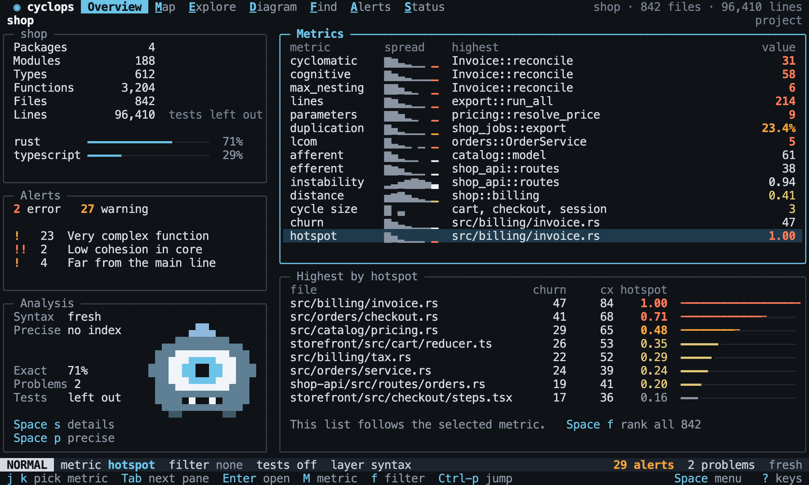
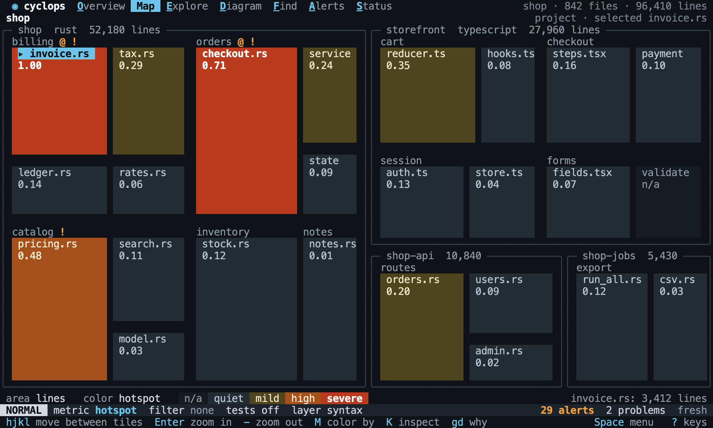
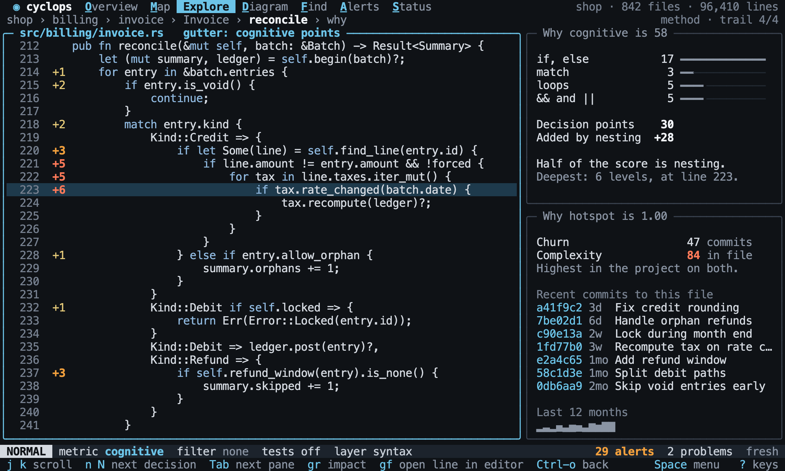

# Cyclops

Cyclops helps you understand a codebase and judge its health. Point it at a project
and it builds a map of the code, from packages down to single functions, with quality
metrics attached to the parts they describe. Then you explore it from your terminal.



*The Overview, as drawn in the design. Every screen in this README comes from
[the design](specs/tui/design/README.md), on a made-up project.*

## Why

Most quality tools hand you a flat list of numbers or warnings. That tells you a
function is complex, but not where it sits, what depends on it, or whether anyone ever
changes it. Diagrams have the opposite problem: they show structure and say nothing
about quality.

On a large repository you need both at once, to answer questions like these:

- How is this project organized, and how do its parts depend on each other?
- Where is the risk concentrated?
- What should we refactor first, and what would that touch?
- Is this part of the code in better or worse shape than the rest?

Cyclops is built around those four questions.

## What it measures

Every metric is reported on its own. There is no combined health score, on purpose: a
single number hides the cause and is easy to game.

| Area                  | What it tells you                                                   |
| --------------------- | ------------------------------------------------------------------- |
| Cyclomatic complexity | How many independent paths run through a function                   |
| Cognitive complexity  | How hard a function is for a person to follow                       |
| Size                  | Lines, parameters, nesting depth, comments and blank lines          |
| Duplication           | Repeated code, and how much of each file it covers                  |
| Cohesion              | Whether a type's members belong together (LCOM)                     |
| Coupling              | Who depends on whom: instability, abstractness, distance            |
| Dependency cycles     | Groups of modules that depend on each other                         |
| Hotspots              | Code that is both complex and changed often, according to git       |

Each metric is measured where it makes sense: complexity on functions, cohesion on
types, coupling on modules, churn on files. Larger parts show a rollup, such as the
highest complexity inside a module. The [metric catalog](specs/metrics/catalog.md)
lists them all.

Colors follow risk, not rank. A healthy project stays calm instead of always having a
red "worst" part, and metrics that only describe something, such as instability, are
never colored as a problem.

## Languages

Rust, TypeScript, JavaScript, Python, Gleam and Elixir are supported. Each language is
an adapter that turns source code into a shared model, and every metric works on that
model, so adding a language does not mean rewriting the metrics.

## Install

On macOS with Apple silicon, or on Linux on x86-64 or ARM64:

```sh
curl -fsSL https://raw.githubusercontent.com/killertux/cyclops/main/install.sh | sh
```

The script downloads the latest release for your machine, checks its checksum, and
puts `cyclops` in `~/.local/bin`. Set `CYCLOPS_VERSION` to install a given release, such
as `v0.1.0`, or `CYCLOPS_INSTALL_DIR` to install somewhere else:

```sh
curl -fsSL https://raw.githubusercontent.com/killertux/cyclops/main/install.sh | CYCLOPS_INSTALL_DIR=/usr/local/bin sh
```

The Linux builds need glibc 2.35 or later, as on Ubuntu 22.04, Debian 12 or Fedora 36.
Every build is also on the [releases page](https://github.com/killertux/cyclops/releases).

### From source

Cyclops is written in Rust. With a recent toolchain (edition 2024) and a C compiler:

```sh
git clone git@github.com:killertux/cyclops.git
cd cyclops
cargo install --path crates/cyclops-cli
```

## Getting started

In any project:

```sh
cyclops
```

The first run analyzes the project and opens the interface. You can browse while the
analysis is still running. Later runs only redo what changed.

## The terminal interface

The interface follows Vim. `Space` opens a menu of views, `?` lists the keys of the
current view, and anything you can click also has a key.

| View     | What it is for                                                                |
| -------- | ----------------------------------------------------------------------------- |
| Overview | Where to look first: every metric, its spread, and the worst part for each.   |
| Map      | How big each part is and where the risk is, as a treemap of the files.        |
| Explore  | The project as a tree with the current metric beside every row.               |
| Why      | The source of a function, with the reasons behind its score.                  |
| Diagram  | Modules, types and their relations, like UML, with metrics on the boxes.      |
| Find     | Every symbol that matches a filter, sorted by any metric.                     |
| Alerts   | The rules that matter for this project, and what breaks them.                 |
| Status   | How far to trust what you see: what is proven, and what was left out.         |

A few ideas tie the views together:

- **The lens** is the current metric, filter and test-code setting. It carries across
  every view, so switching from the Map to the Diagram keeps you looking at the same
  thing. `M` picks a metric and `f` writes a filter, such as
  `kind = function and cyclomatic > 15`.
- **The focus** is the symbol you are looking at. It also stays put when you change
  views. `Ctrl-p` jumps to any symbol, and `Ctrl-o` goes back, like Vim's jump list.
- **`gd` asks "why?"** On a function it opens Why: the whole file, centered on that
  function, with the points each line added in the margin. On a larger part it opens
  its worst function.





## The command line

Everything the interface shows is also available to scripts and CI:

| Command             | What it does                                                    |
| ------------------- | --------------------------------------------------------------- |
| `cyclops init`      | Creates `.cyclops/` with default settings for the team.         |
| `cyclops analyze`   | Refreshes the analysis and prints a summary.                    |
| `cyclops report`    | Prints every metric, as a table or as JSON.                     |
| `cyclops query`     | Lists the symbols that match a filter.                          |
| `cyclops check`     | Fails when an alert rule is broken, for use in CI.              |
| `cyclops export`    | Prints a diagram as Mermaid, PlantUML or Graphviz DOT.          |

For example:

```sh
cyclops query 'kind = method and cyclomatic > 10' --sort 'cyclomatic desc'
cyclops check --fail-on error
cyclops export --format mermaid --level type --overlay cyclomatic
```

All commands work on the current folder, or the one given with `-C`. See
[the commands](specs/cli/commands.md) for every option and exit code.

## Settings and alerts

Each project gets a `.cyclops/` folder at its root. Its `config.toml` holds the
project's settings and alert rules, and is meant to be committed so a team shares
them. The cache next to it stays on your machine.

```toml
[[alerts]]
name = "Very complex function"
metric = "cyclomatic"
scope = "function"
when = "> 15"
severity = "warning"
```

Alerts show up while you browse, and `cyclops check` turns them into a failing build.
Personal preferences go in `~/.config/cyclops/config.toml` and never affect the team's
checks.

## How it works

Cyclops reads a project in a few steps:

1. **Find** the source files, skipping what `.gitignore` excludes.
2. **Extract** facts from each file: its symbols, branches, calls and imports. This is
   the expensive step, so it runs in parallel and is cached by file content.
3. **Link** those facts into one model of the project: packages, modules, types and
   functions, and the relations between them.
4. **Measure** every metric on that model, and roll them up to larger parts.

The analysis has two layers. A fast **syntax layer** always runs and needs nothing
installed. It reads each file on its own, so some relations, such as which `total`
a call refers to, are educated guesses, and Cyclops marks them as such. An optional
**precise layer** asks each language's compiler tooling (`rust-analyzer`,
`scip-typescript`, `scip-python`) for the exact answer. It is slower, so you ask for it with
`Space p` in the interface or `cyclops analyze --precise`.

All the analysis lives in a core with no dependency on any interface. The terminal
interface and the command line are thin layers on top of it, so they cannot drift
apart, and a graphical or web interface could be added later without touching the
analysis. [PROPOSAL.md](PROPOSAL.md) describes the architecture in detail.

## The specification

How Cyclops behaves is written down in [`specs/`](specs/README.md), and every table in
it is an executable test, run with [temoc](https://github.com/killertux/temoc) against
small sample projects in [`samples/`](samples). A page describes a behavior and proves
it at the same time. New behavior starts there, as a table, before any code is
written.

To run everything:

```sh
cargo test --workspace --all-features
temoc -c temoc.toml
```

## Releasing

Pushing a tag such as `v0.2.0` builds Cyclops for every platform and publishes a
release, which the install script then finds. The tag must match the version in the
workspace's `Cargo.toml`, so bump that first:

```sh
git tag v0.2.0
git push origin v0.2.0
```

## Repository layout

| Path                            | What is there                                    |
| ------------------------------- | ------------------------------------------------ |
| `crates/cyclops-domain`         | The model, metrics, filters and alert rules      |
| `crates/cyclops-application`    | The analysis and the queries over it             |
| `crates/cyclops-lang-rust`      | The Rust adapter                                 |
| `crates/cyclops-lang-typescript`| The TypeScript and JavaScript adapter            |
| `crates/cyclops-lang-python`    | The Python adapter                               |
| `crates/cyclops-lang-gleam`     | The Gleam adapter                                |
| `crates/cyclops-lang-elixir`    | The Elixir adapter                               |
| `crates/cyclops-semantic`       | The precise layer, through compiler tooling      |
| `crates/cyclops-infra`          | Files, git, the cache and settings               |
| `crates/cyclops-tui`            | The terminal interface                           |
| `crates/cyclops-cli`            | The `cyclops` binary                             |
| `specs/`                        | The executable specification                     |
| `samples/`                      | The projects the specification runs against      |
| `fixtures/`                     | The glue between the specification and the code  |

## Further reading

- [IDEA.md](IDEA.md): the vision, and what is out of scope for now.
- [PROPOSAL.md](PROPOSAL.md): the architecture.
- [specs/README.md](specs/README.md): how Cyclops behaves, page by page.
- [AGENTS.md](AGENTS.md): the rules for anyone, human or agent, changing the code.
