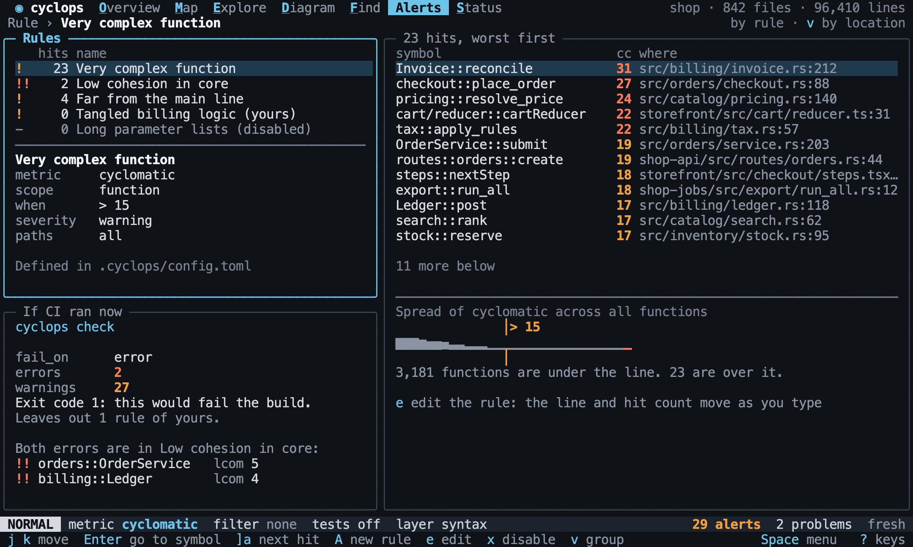
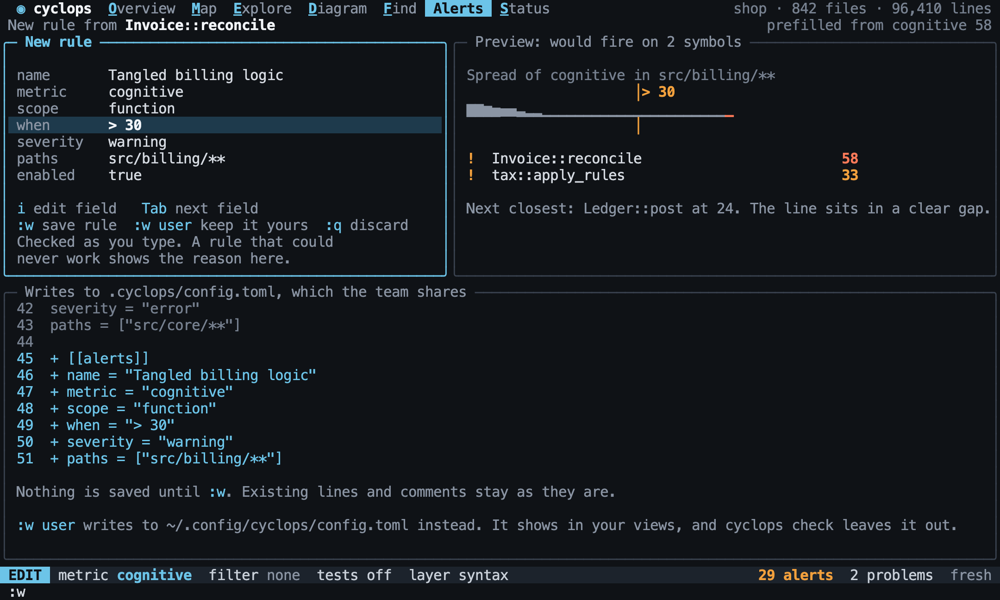

# Alerts

Back to the [terminal interface](README.md).

Alerts shows the thresholds that matter to the project and what is breaking them. Rules
are the [same rules](../explore/alerts.md) that `cyclops check` uses, so the interface can
create and change them, and the team shares the result.

## Rules and hits

The left side lists the rules, and the right side lists the hits of the selected rule,
worst first. `v` groups the hits by location instead. `Enter` opens a hit.

[//]: # "import Spec.Fixtures"
[//]: # "decisionTable Tui -- snooze until 2099-12-31"

| # situation | workspace | steps                                                                                | keys        | rules?                                           | rows?                                                     |
| ----------- | --------- | ------------------------------------------------------------------------------------ | ----------- | ------------------------------------------------ | --------------------------------------------------------- |
| No rules    | rust-shop |                                                                                      | `<Space>a`  | none                                             | none                                                      |
| A rule      | rust-shop | `add alert cyclomatic function > 1 warning`                                          | `<Space>a`  | cyclomatic function > 1                          | shop::orders::Order::total, shop::billing::Invoice::total |
| Several     | rust-shop | `add alert cyclomatic function > 1 warning; add alert instability module >= 1 error` | `<Space>a`  | instability module >= 1, cyclomatic function > 1 | shop::orders                                              |
| By location | rust-shop | `add alert cyclomatic function > 1 warning`                                          | `<Space>av` | cyclomatic function > 1                          | shop::billing, shop::orders                               |

Errors come before warnings, and a disabled rule stays in the list with no hits.
Rules from your [own file](../project/configuration.md#your-own-settings) are labelled.

[//]: # "decisionTable Tui -- snooze until 2099-12-31"

| # situation | workspace | steps                                                | keys       | has?       |
| ----------- | --------- | ---------------------------------------------------- | ---------- | ---------- |
| Disabled    | rust-shop | `add alert cyclomatic function > 1 warning disabled` | `<Space>a` | (disabled) |
| Your own    | rust-shop | `add user alert cyclomatic function > 1 warning`     | `<Space>a` | (yours)    |

## Stepping through hits

`]a` and `[a` move the focus through every alert, from any view, worst first.

[//]: # "decisionTable Tui -- snooze until 2099-12-31"

| # situation  | workspace | steps                                       | keys                | view?    | focus?                        |
| ------------ | --------- | ------------------------------------------- | ------------------- | -------- | ----------------------------- |
| Opening      | rust-shop | `add alert cyclomatic function > 1 warning` | `<Space>a<Tab><CR>` | Explore  | shop::orders::Order::total    |
| The next     | rust-shop | `add alert cyclomatic function > 1 warning` | `]a`                | Explore  | shop::orders::Order::total    |
| And the next | rust-shop | `add alert cyclomatic function > 1 warning` | `]a]a`              | Explore  | shop::billing::Invoice::total |
| Back         | rust-shop | `add alert cyclomatic function > 1 warning` | `]a]a[a`            | Explore  | shop::orders::Order::total    |
| None         | rust-shop |                                             | `]a`                | Overview | shop                          |

## What CI would do

The view shows what [`cyclops check`](../cli/commands.md#checking-alerts) would do now, which
is what CI would do. `cyclops check` ignores your own file, so your rules show their hits
here but never change the exit code. The view says how many it left out.

[//]: # "decisionTable Tui -- snooze until 2099-12-31"

| # situation | workspace | steps                                                                  | keys       | has?                        |
| ----------- | --------- | ---------------------------------------------------------------------- | ---------- | --------------------------- |
| It passes   | rust-shop | `add alert cyclomatic function > 2 warning`                            | `<Space>a` | Exit code 0                 |
| It fails    | rust-shop | `add alert cyclomatic function > 2 error`                              | `<Space>a` | Exit code 1                 |
| Stricter    | rust-shop | `add alert cyclomatic function > 2 warning; set check.fail_on warning` | `<Space>a` | Exit code 1                 |
| Your rules  | rust-shop | `add user alert cyclomatic function > 2 error`                         | `<Space>a` | Exit code 0                 |
| Saying so   | rust-shop | `add user alert cyclomatic function > 2 error`                         | `<Space>a` | Leaves out 1 rule of yours. |

## A new rule

`A` starts a rule from the focus, from any view. It takes its metric from the lens and
its scope from the focus, and its threshold is set so that the focus would fire. A
rule is edited like a buffer: `i` edits a field, `Tab` moves to the next one, `:w` saves
and `:q` leaves without saving. It starts on `when`, and the fields are `name`, `metric`,
`scope`, `when`, `severity`, `paths` and `enabled`. `Esc` leaves a field and drops what was
typed in it, and the rule stays open. `field?` is the current field.

`rule?` is the rule being edited, as `METRIC SCOPE WHEN SEVERITY`, and `hits?` is how
many symbols it would fire on. Both update as you type, so a threshold can be tried
before it is saved. The rule is checked as you type, with the messages from
[invalid rules](../explore/alerts.md#invalid-rules).

[//]: # "decisionTable Tui -- snooze until 2099-12-31"

| # situation     | workspace | keys                                       | mode? | rule?                                | hits? | has?                        |
| --------------- | --------- | ------------------------------------------ | ----- | ------------------------------------ | ----- | --------------------------- |
| From a function | rust-shop | `<C-p>Order::total<CR>A`                   | EDIT  | cyclomatic function >= 3 warning     | 1     | + [[alerts]]                |
| From a module   | rust-shop | `<Space>ejMinstability<CR>A`               | EDIT  | instability module >= 1.00 warning   | 1     | + [[alerts]]                |
| Trying a value  | rust-shop | `<C-p>Order::total<CR>Ai<C-u>> 1<CR>`      | EDIT  | cyclomatic function > 1 warning      | 2     | Next closest                |
| A bad value     | rust-shop | `<C-p>Order::total<CR>Ai<C-u>around 1<CR>` | EDIT  | cyclomatic function around 1 warning | 0     | Invalid threshold: around 1 |

[//]: # "decisionTable Tui -- snooze until 2099-12-31"

| # situation     | workspace | keys                                   | mode? | field?   | rule?                            |
| --------------- | --------- | -------------------------------------- | ----- | -------- | -------------------------------- |
| It starts here  | rust-shop | `<C-p>Order::total<CR>A`               | EDIT  | when     | cyclomatic function >= 3 warning |
| The next field  | rust-shop | `<C-p>Order::total<CR>A<Tab>`          | EDIT  | severity | cyclomatic function >= 3 warning |
| Leaving a field | rust-shop | `<C-p>Order::total<CR>Ai<C-u>> 1<Esc>` | EDIT  | when     | cyclomatic function >= 3 warning |

## Saving

Saving writes to `.cyclops/config.toml` and keeps every line already in it, comments
included. The change to the file is shown before it is saved. Hits update straight
after, with no parsing. A rule that could not work is refused, and nothing is written.

[//]: # "decisionTable Tui -- snooze until 2099-12-31"

| # situation   | workspace | steps                          | keys                                             | mode?  | config has?           | config lacks? |
| ------------- | --------- | ------------------------------ | ------------------------------------------------ | ------ | --------------------- | ------------- |
| Saving        | rust-shop |                                | `<C-p>Order::total<CR>A:w<CR>`                   | NORMAL | metric = "cyclomatic" | none          |
| Leaving       | rust-shop |                                | `<C-p>Order::total<CR>A:q<CR>`                   | NORMAL | none                  | [[alerts]]    |
| Refused       | rust-shop |                                | `<C-p>Order::total<CR>Ai<C-u>around 1<CR>:w<CR>` | EDIT   | none                  | [[alerts]]    |
| Comments stay | rust-shop | `add config comment keep this` | `<C-p>Order::total<CR>A:w<CR>`                   | NORMAL | # keep this           | none          |
| Hits appear   | rust-shop |                                | `<C-p>Order::total<CR>A:w<CR><Space>a`           | NORMAL | [[alerts]]            | none          |

`:w user` saves the rule to [your own file](../project/configuration.md#your-own-settings)
instead. `user config has?` reads that file.

[//]: # "decisionTable Tui -- snooze until 2099-12-31"

| # situation | workspace | keys                                | mode?  | user config has?      | config lacks? |
| ----------- | --------- | ----------------------------------- | ------ | --------------------- | ------------- |
| Your own    | rust-shop | `<C-p>Order::total<CR>A:w user<CR>` | NORMAL | metric = "cyclomatic" | [[alerts]]    |

## Changing a rule

`e` edits the selected rule, and `x` disables it, or enables it again.

[//]: # "decisionTable Tui -- snooze until 2099-12-31"

| # situation | workspace | steps                                                | keys                           | config has?     |
| ----------- | --------- | ---------------------------------------------------- | ------------------------------ | --------------- |
| Editing     | rust-shop | `add alert cyclomatic function > 2 warning`          | `<Space>aei<C-u>> 1<CR>:w<CR>` | when = "> 1"    |
| Disabling   | rust-shop | `add alert cyclomatic function > 2 warning`          | `<Space>ax`                    | enabled = false |
| Enabling    | rust-shop | `add alert cyclomatic function > 2 warning disabled` | `<Space>ax`                    | enabled = true  |

A rule stays in the file it came from.

[//]: # "decisionTable Tui -- snooze until 2099-12-31"

| # situation | workspace | steps                                            | keys                           | user config has? | config lacks? |
| ----------- | --------- | ------------------------------------------------ | ------------------------------ | ---------------- | ------------- |
| Your own    | rust-shop | `add user alert cyclomatic function > 2 warning` | `<Space>aei<C-u>> 1<CR>:w<CR>` | when = "> 1"     | [[alerts]]    |
