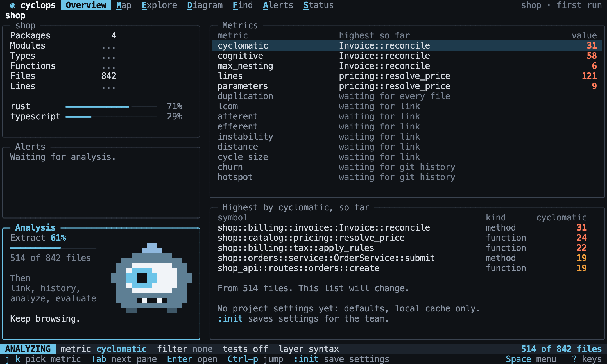

# Analysis

Back to the [terminal interface](README.md).

The interface never makes you wait. Analysis runs in the background, and each panel
fills in when its data is ready. You can browse, jump and filter the whole time.

## The first run

With nothing cached, the interface opens on Overview straight away, in the mode
ANALYZING. Keys work as they do in NORMAL. Complexity and size are known file by file,
so they appear first and are labelled as partial. What needs the whole project says
what it is waiting for, and never shows a number it does not have yet.

`pause before STEP` holds the analysis at a [pipeline](status.md#the-pipeline) step,
and `<resume>` lets it finish.

[//]: # "import Spec.Fixtures"
[//]: # "decisionTable Tui -- snooze until 2099-12-31"

| # situation       | workspace | steps                            | keys                 | mode?     | view?    | text                    | includes? | other text | other includes? |
| ----------------- | --------- | -------------------------------- | -------------------- | --------- | -------- | ----------------------- | --------- | ---------- | --------------- |
| Opens at once     | rust-shop | `pause before extract`           |                      | ANALYZING | Overview | Analysis                | yes       | none       | no              |
| Partial results   | rust-shop | `pause before link`              |                      | ANALYZING | Overview | so far                  | yes       | none       | no              |
| Needs the links   | rust-shop | `pause before link`              |                      | ANALYZING | Overview | waiting for link        | yes       | none       | no              |
| Needs the history | rust-shop | `git init; pause before history` |                      | ANALYZING | Overview | waiting for git history | yes       | none       | no              |
| Browsing          | rust-shop | `pause before link`              | `<Space>e`           | ANALYZING | Explore  | Structure               | yes       | none       | no              |
| Filtering         | rust-shop | `pause before link`              | `fkind = struct<CR>` | ANALYZING | Overview | kind = struct           | yes       | none       | no              |
| It finishes       | rust-shop | `pause before link`              | `<resume>`           | NORMAL    | Overview | fresh                   | yes       | so far     | no              |
| The view stays    | rust-shop | `pause before link`              | `<Space>e<resume>`   | NORMAL    | Explore  | Structure               | yes       | so far     | no              |

Results from a cache need no waiting, and an analysis with nothing to do says so.

[//]: # "decisionTable Tui"

| # situation  | workspace | steps     | mode?  | text                   | includes? |
| ------------ | --------- | --------- | ------ | ---------------------- | --------- |
| From a cache | rust-shop | `analyze` | NORMAL | fresh                  | yes       |
| No sources   | docs-only |           | NORMAL | No source files found. | yes       |

Analysis works without `cyclops init`, as [initializing](../project/initializing.md#without-initializing)
explains. The interface says which settings are in use, and `:init` saves them.

[//]: # "decisionTable Tui -- snooze until 2099-12-31"

| # situation     | workspace | steps                                        | keys        | text                    | includes? | other text              | other includes? | created?             |
| --------------- | --------- | -------------------------------------------- | ----------- | ----------------------- | --------- | ----------------------- | --------------- | -------------------- |
| Not initialized | rust-shop | `pause before link`                          |             | No project settings yet | yes       | none                    | no              | none                 |
| Saving them     | rust-shop | `pause before link`                          | `:init<CR>` | Analysis                | yes       | No project settings yet | no              | .cyclops/config.toml |
| Already set up  | rust-shop | `set tests.include false; pause before link` |             | Analysis                | yes       | No project settings yet | no              | none                 |

Quitting during an analysis stops it, and what was finished stays in the cache.

[//]: # "decisionTable Tui -- snooze until 2099-12-31"

| # situation | workspace | steps               | keys       | running? |
| ----------- | --------- | ------------------- | ---------- | -------- |
| Quitting    | rust-shop | `pause before link` | `<Space>q` | no       |

## Refreshing

When a file changes, the status line says `stale`. Cyclops does not refresh by itself,
so the screen never moves under you. `Space r` refreshes, and only changed files are
parsed again, as [caching](../analysis/caching.md) describes. `parsed?` is how many
files the last refresh parsed.

[//]: # "decisionTable Tui -- snooze until 2099-12-31"

| # situation   | workspace | keys                                  | parsed? | text  | includes? |
| ------------- | --------- | ------------------------------------- | ------- | ----- | --------- |
| Nothing new   | rust-shop | `<Space>r`                            | 0       | fresh | yes       |
| One file      | rust-shop | `<step edit src/orders.rs><Space>r`   | 1       | fresh | yes       |
| Not refreshed | rust-shop | `<step edit src/orders.rs><wait 500>` | 0       | stale | yes       |

A refresh keeps the view and the lens. If the focus no longer exists, it moves to the
nearest parent that does, and says so.

[//]: # "decisionTable Tui -- snooze until 2099-12-31"

| # situation | workspace | keys                                                     | view?   | focus?                     | text             | includes? |
| ----------- | --------- | -------------------------------------------------------- | ------- | -------------------------- | ---------------- | --------- |
| It stays    | rust-shop | `<C-p>Order::total<CR><step edit src/orders.rs><Space>r` | Explore | shop::orders::Order::total | Structure        | yes       |
| It is gone  | rust-shop | `<C-p>greeting<CR><step delete src/notes.rs><Space>r`    | Explore | shop                       | greeting is gone | yes       |
