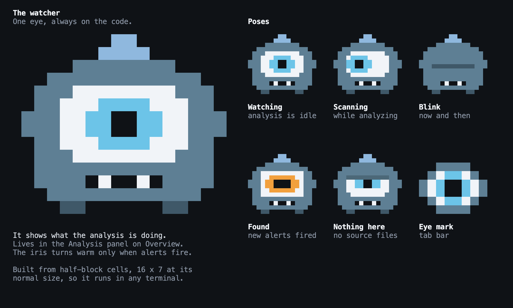

# The Design

Back to the [terminal interface](../README.md).

This folder says what the interface looks like. The pages in `specs/tui/` say how it
behaves. An implementation needs both, and neither repeats the other.

| Path                      | What it is                                                                                 |
| ------------------------- | ------------------------------------------------------------------------------------------ |
| `screens/NAME.txt`        | The exact characters of a screen, cell by cell. **The reference for layout.**              |
| `screens/NAME.cells.json` | The style of every cell, as runs of `[column, text, style, background]`, one list per row. |
| `screens/NAME.dark.png`   | A picture of the screen in the dark theme.                                                 |
| `screens/NAME.light.png`  | A picture of the screen in the light theme.                                                |
| `tokens.json`             | Every style token, for both themes. **The reference for color.**                           |
| `source/`                 | The editable design, as it was drawn on the canvas.                                        |
| `render.mjs`              | Regenerates `screens/` and `tokens.json` from `source/`.                                   |

If two of these disagree, `screens/` and `tokens.json` win. `source/` draws lines with
CSS for a canvas, and `render.mjs` turns them into the glyphs a terminal really shows.
Never edit `screens/` by hand. To change the design, change `source/` and run one of:

```sh
CHROME=/path/to/chrome node specs/tui/design/render.mjs
FIREFOX=/path/to/firefox node specs/tui/design/render.mjs
```

With neither, only the text and cell files are written. `ONLY=alerts,why` limits the PNGs to
those screens, since a small change rarely needs all of them drawn again.

**The data on screen is made up**, from a scaled-up `samples/rust-shop`. Copy the layout,
the labels and the styles, never the numbers or the symbol names.

## Screens

| Screen                               | Files              | Behavior                                  |
| ------------------------------------ | ------------------ | ----------------------------------------- |
| Overview, indexing                   | `overview`         | [Overview](../overview.md)                |
| Overview, indexing with a percentage | `overview-percent` | [Overview](../overview.md)                |
| Overview, idle                       | `overview-idle`    | [Overview](../overview.md)                |
| First run                            | `first-run`        | [Analysis](../analysis.md)                |
| Map                                  | `map`              | [Map](../map.md)                          |
| Explore with the inspector           | `explore`          | [Explore](../explore.md)                  |
| Why                                  | `why`              | [Why](../why.md)                          |
| Why, for cohesion                    | `why-cohesion`     | [Why](../why.md#what-it-explains)         |
| Why, the other forms                 | `why-forms`        | [Why](../why.md#what-it-explains)         |
| Diagram with Impact                  | `diagram`          | [Diagram](../diagram.md)                  |
| Diagram of types                     | `diagram-types`    | [Diagram](../diagram.md#class-boxes)      |
| The rest of a `+N more` node         | `more-nodes`       | [Diagram](../diagram.md)                  |
| The relation picker                  | `relation-picker`  | [Diagram](../diagram.md)                  |
| The metric picker                    | `metric-picker`    | [The lens](../lens.md#the-metric)         |
| Find, editing a filter               | `find`             | [Find](../find.md)                        |
| Alerts                               | `alerts`           | [Alerts](../alerts.md)                    |
| New rule                             | `alert-rule`       | [Alerts](../alerts.md#a-new-rule)         |
| Status                               | `status`           | [Status](../status.md)                    |
| Status, indexing                     | `status-running`   | [Status](../status.md#precise-analysis)   |
| Status, asking before indexing       | `status-confirm`   | [Status](../status.md#precise-analysis)   |
| The Space menu                       | `space-menu`       | [Keys](../keys.md#the-space-menu)         |
| The right-click menu                 | `context-menu`     | [Mouse](../mouse.md#the-right-click-menu) |
| A small terminal, 80 x 24            | `small-terminal`   | [The shell](../shell.md#sizes)            |
| Every token and mark                 | `visual-language`  | This page                                 |
| The mascot                           | `mascot`           | [The mascot](#the-mascot)                 |

## Principles

- **Warm means risk, cool means the interface.** The interface only uses gray and
  one blue. Yellow, orange and red appear only on measurements of code health. Never
  use a warm color for chrome, and never use the accent for a measurement.
- **Numbers are printed.** Color and bars only reinforce a value that is on screen.
- **Nothing relies on color alone.** Every state also has a mark, a line style or bold.
- **Quiet by default.** Most of the screen is gray, so that what is hot stands out.

## The grid

The design is drawn on a terminal of 120 columns by 36 rows, and each screen must match
at that size. A cell is one character. Every glyph is one cell wide.

## The shell

The first two rows and the last two rows are the same in every view.

| Row      | Content                                                                                                                                                                                                                                     |
| -------- | ------------------------------------------------------------------------------------------------------------------------------------------------------------------------------------------------------------------------------------------- |
| 0        | `◉` in column 2, `cyclops` in column 4, tabs from column 12, and the project summary ending at the second to last column. The current tab uses `on`. Others use `dim`, with the first letter in `key`.                                      |
| 1        | The breadcrumb from column 1, separated by ` › `, with the last part in `b`. On the right: the kind of the focus and the trail, in `faint`.                                                                                                 |
| 2 to n-3 | The view.                                                                                                                                                                                                                                   |
| n-2      | The status line, filled with `chip`. The mode in `mode`, or `on` for any mode but NORMAL, then `metric`, `filter`, `tests` and `layer`. On the right: alerts in `chiph`, problems, then `fresh` in `chipd`, or the running task in `chipa`. |
| n-1      | The hint line: a key in `acc` and its meaning in `dim`, three spaces apart. On the right: `Space menu` and `? keys`. A prompt replaces this row, starting at column 0.                                                                      |

## Panes

Panes use the rounded box `╭─╮│╰╯`, with the title at column 2 of the top edge and a
space on each side of it. A pane that has the keyboard has its border in `acc` and its
title in `accb`. Others use `line` and `dim`.

A selected row has the background `sel`, across the whole pane.

Text that does not fit ends in `…`. It never runs into a value or a border. Values sit in
their own right-aligned column, with at least one space before them.

Popups fill their area with `pop`, draw their border in `popk`, and sit over the view.
The Space menu is docked at the bottom of the view, across its whole width. The
right-click menu opens at the mouse. Popup text uses `pop`, `popb`, `popd` and `popk`, and
the current entry uses `pops`.

| Popup           | Content                                                                                                                                                                                     |
| --------------- | ------------------------------------------------------------------------------------------------------------------------------------------------------------------------------------------- |
| Metric picker   | A prompt, then all 18 metrics of the [catalog](../../metrics/catalog.md), with what each measures, and `neutral` on the right where it applies. The Overview list is the main metrics only. |
| Relation picker | A prompt, then each kind with `[x]` or `[ ]`, its arrowhead, and what it means.                                                                                                             |
| More nodes      | What a `+N more` node holds, worst first, with the metric and the confidence. `Enter` selects it, and it replaces the last node of the column.                                              |

## Focus and selection

The two differ on a map and a diagram, so they never look the same.

|           | Focus                                                                            | Selection                                                      |
| --------- | -------------------------------------------------------------------------------- | -------------------------------------------------------------- |
| On a node | A heavy border `┏━┓┃┗┛` in `acc`, with the name in `accb`.                       | `▸` before the name, in `accb`, and `sel` across the name row. |
| On a tile | Not a tile. A map is drawn inside its focus, which is the end of the breadcrumb. | `▸` before the name, and the name in `on`.                     |
| In a row  | The same as the selection.                                                       | `sel` across the row.                                          |

A node that is both has both. Both survive `NO_COLOR`, since one is a line weight and the
other is a glyph.

The inspector shows the selection. When that is not the focus, its title becomes
`Selected: NAME`, and the right of row 1 adds `selected NAME`, as `diagram-types` shows. When
they are the same, the title stays `Inspector`.

A focus with nothing inside it, such as a function, shows its parent's map with its own
tile selected.

## Filters on a map or diagram

A kept tile or node keeps its whole value and its color, so nothing on it changes. What
was left out is said once: the map's legend row ends with `1 of 4 tiles`, and the diagram's
control row ends with `1 of 4 nodes`, in `dim`. The filter itself stays in the status line.

## Resizing

The design is exact at 120 by 36. These rules say how each layout stretches, and
`small-terminal` shows the smallest size. Fixed sizes are in columns or rows.

| View     | Rule                                                                                                                                             |
| -------- | ------------------------------------------------------------------------------------------------------------------------------------------------ |
| Overview | Left column fixed at 40. The metrics pane is 18 rows, and the ranking takes the rest. Below 100 columns, the left column is hidden behind `Tab`. |
| Map      | Fills the view, with one row below for the legend. Tiles use a squarified treemap, with a gap of one cell.                                       |
| Explore  | The inspector is fixed at 58, and can be dragged. The tree takes the rest.                                                                       |
| Why      | The reasons pane is fixed at 40, and the source takes the rest.                                                                                  |
| Diagram  | The inspector is fixed at 36 when open. The diagram takes the rest.                                                                              |
| Find     | The filter bar is fixed at 3 rows. The symbol column takes the spare width.                                                                      |
| Alerts   | The rules pane is fixed at 50, and the hits take the rest.                                                                                       |
| Status   | Two columns, the left fixed at 56. Panes keep their order and stack below 100 columns.                                                           |

Below 100 columns, an open inspector covers the whole view.

## Tokens

`tokens.json` holds each token for `dark` and `light`, with its foreground, background,
bold and underline. `ground` is the background of the screen.

| Tokens                                        | Used for                                                  |
| --------------------------------------------- | --------------------------------------------------------- |
| `fg`, `b`                                     | Text, and strong text.                                    |
| `dim`, `faint`                                | Secondary text, and column headings.                      |
| `acc`, `accb`, `key`                          | Keys, focus and the interface accent.                     |
| `line`, `track`                               | Pane borders, and the empty part of a bar.                |
| `h0`, `h1`, `h2`, `h3`                        | Text and bars for values with heat, from quiet to severe. |
| `t0`, `t1`, `t2`, `t3`, `t4`                  | Map tiles: no heat, then quiet to severe.                 |
| `on`, `mode`                                  | The current tab, and the mode in the status line.         |
| `chip`, `chipa`, `chiph`, `chipd`             | The status line: text, active value, alerts, and quiet.   |
| `pop`, `popb`, `popd`, `popk`, `pops`, `poph` | Popups.                                                   |
| `sel`                                         | The background of a selection.                            |
| `kw`, `str`                                   | Source code: keywords and strings.                        |
| `px.*`                                        | The mascot's pixels.                                      |

### Heat

The core gives each value a [heat level](../../metrics/catalog.md#heat), from fixed reference
values, so a healthy project stays quiet. An interface never works it out.

| Heat     | Text and bars | Map tile | Meaning                                    |
| -------- | ------------- | -------- | ------------------------------------------ |
| None     | `fg`          | `t0`     | A neutral metric, or a value that is `n/a` |
| `quiet`  | `h0`          | `t1`     | Measured, and nothing to worry about       |
| `mild`   | `h1`          | `t2`     | Worth a look                               |
| `high`   | `h2`          | `t3`     | A problem                                  |
| `severe` | `h3`          | `t4`     | A serious problem                          |

`t0` and `t1` are cool grays, because neither one is a risk. Warm starts at `mild`.

### Neutral metrics

[Neutral](../../metrics/catalog.md#direction) metrics describe, and never warn. They have no
heat, so they are never warm: text uses `fg`, tiles use `t0`, and a spread marks its range in
`b`. `lines` only has heat on functions, so it is neutral on a file or a module. Every metric
is better low or neutral, so the Overview says `highest` rather than `worst`, which is true of
both.

## Glyphs

| Meaning                     | Glyphs                                                                                                                                                                                                    |
| --------------------------- | --------------------------------------------------------------------------------------------------------------------------------------------------------------------------------------------------------- |
| Exact relation              | `─ │ ┌ ┐ └ ┘ ├ ┤ ┬ ┴ ┼`                                                                                                                                                                                   |
| Inferred relation           | `╌ ╎`, with the same corners                                                                                                                                                                              |
| Ambiguous relation          | `┄ ┆`, with the same corners                                                                                                                                                                              |
| Relation in a cycle         | `━ ┃ ┏ ┓ ┗ ┛ ┣ ┫ ┳ ┻ ╋`, in `h3`                                                                                                                                                                          |
| An arrow                    | `>` or `<`, in the cell before the node                                                                                                                                                                   |
| A bar                       | `━` for the filled part, `╸` for a half cell, `─` in `track` for the rest                                                                                                                                 |
| A spread                    | `▁▂▃▄▅▆▇`, one cell for each of the eight ranges, in `dim`. It stops short of `█`, so that spreads on neighboring rows stay apart. The range holding the symbol uses its heat token, or `b` with no heat. |
| A closed and an open branch | `▸` and `▾`                                                                                                                                                                                               |
| A divider in a class box    | `├─┤`, or `┠─┨` in `acc` on the focus                                                                                                                                                                     |
| A compartment that is cut   | `+N more` in `faint`, as the last row                                                                                                                                                                     |

### Relation kinds

Line style is taken by confidence, so the kind is the arrowhead. A head is one cell, drawn
apart from the line, so every kind works in every line style and in `NO_COLOR`.

| Kind                       | Head    | Where                                  |
| -------------------------- | ------- | -------------------------------------- |
| `imports`, `uses`, `calls` | `>` `<` | At the target                          |
| `inherits`                 | `▷` `◁` | At the parent                          |
| `implements`               | `○`     | At the interface, like a UML lollipop  |
| `composes`                 | `◆`     | At the owner, with no head at the part |

Every diagram keeps a legend of both, as its last rows.

## Marks

| Mark  | Style   | Meaning                                                                  |
| ----- | ------- | ------------------------------------------------------------------------ |
| `!`   | `h2`    | A warning alert                                                          |
| `!!`  | `h3`    | An error alert                                                           |
| `@`   | `h2`    | In a dependency cycle. On a class box, its module is. Never on a member. |
| `~`   | `dim`   | A relation that is a guess                                               |
| `n/a` | `dim`   | A metric that does not apply                                             |
| `*`   | `dim`   | Changed since the semantic index                                         |
| `...` | `faint` | Not known yet                                                            |
| `+`   | `fg`    | A public member                                                          |
| `#`   | `fg`    | A restricted member, such as `protected` or `pub(crate)`                 |
| `-`   | `fg`    | A private member                                                         |

## Without color

With `NO_COLOR`, every token keeps its bold and underline but loses its color. The
selection, the current tab, the mode and the current popup entry use reverse video
instead. Map tiles use their label alone, and `severe` tiles are bold. Line styles,
arrowheads, marks and the heavy border of the focus need no color.

## Class boxes

At type level a node is a class box, 24 columns wide at the design size. `diagram-types` shows
one with each relation kind.

| Part         | Design                                                                                                                              |
| ------------ | ----------------------------------------------------------------------------------------------------------------------------------- |
| Stereotype   | `«interface»`, `«enum»` or `«alias»` in `dim`, on its own row above the name. A struct or class has none.                           |
| Name         | In `b`, or `accb` on the focus, then `!` or `!!` and `@`. The overlay is right-aligned on the same row.                             |
| Compartments | Fields, then methods, split by a divider. An empty compartment is left out.                                                         |
| A member     | `+`, `#` or `-`, then the name, with `()` on a method, then `!` or `!!`, then the overlay on the right. A field shows `n/a`.        |
| Member order | Methods worst first by the overlay. Fields alphabetically.                                                                          |
| Collapsing   | The focus shows up to five rows per compartment, and a neighbor shows up to two. The last row becomes `+N more` when more are left. |
| Expanding    | `Enter` shows every member, scrolling inside the box if needed.                                                                     |
| Edges        | `calls` joins the rows of the two members. The other kinds join the boxes.                                                          |

The model does not record field types or signatures, so rows show names only.

## Why

The right panes of `why` follow the metric of the lens. The title is always `Why METRIC is N`.

| Metric                         | Top panel                                                                          | Bottom panel      |
| ------------------------------ | ---------------------------------------------------------------------------------- | ----------------- |
| `cognitive`                    | Points by structure, `Decision points`, `Added by nesting`, the deepest line.      | History, with git |
| `cyclomatic`                   | Decision points by kind, with each `match` arm counted, and `+1` for the function. | History, with git |
| `max_nesting`                  | The deepest line, and the structures that lead to it.                              | History, with git |
| `lines`, `parameters`          | The value, and how it compares in the file.                                        | History, with git |
| `comment_lines`, `blank_lines` | The value for the file.                                                            | History, with git |
| `churn`, `hotspot`             | Churn and complexity against the highest in the project.                           | The commits       |

The gutter always shows cognitive points, whichever metric is in the lens.

A metric with no lines to point at uses the Why section of the inspector instead, as
`why-cohesion` and `why-forms` show. All the forms share one layout: `Why METRIC is N` in `b`, a
line on what the value is, a list, and the keys in the last row. `Enter` jumps to the row.

| Metric                                                            | The list                                                       |
| ----------------------------------------------------------------- | -------------------------------------------------------------- |
| `members`                                                         | Its fields, then its methods                                   |
| `lcom`                                                            | Each group of methods, numbered, with the fields it uses below |
| `afferent`, `efferent`, `instability`, `abstractness`, `distance` | `Depends on N` and `Depended on by N`                          |
| `cycle_size`                                                      | Each hop around the cycle, with its kind and confidence        |
| `duplication`                                                     | Each copy, with its lines and where each one is                |

## Indexing

Indexers are external processes and may not report progress, so progress is optional.

| State             | Status line       | Analysis panel                  | Status                              |
| ----------------- | ----------------- | ------------------------------- | ----------------------------------- |
| Running           | `indexing 3m 12s` | `Precise running`, `for 3m 12s` | `Running rust-analyzer for 3m 12s.` |
| With a percentage | `indexing 38%`    | `Precise 38%`, and a bar        | The same, with the percentage       |
| Idle              | `fresh`           | `Precise no index`              | `semantic.mode` and the index       |

The mascot scans in both running states. It never shows a bar it cannot fill.

## The mascot

The mascot is a one-eyed watcher that shows what the analysis is doing. It is drawn in
half-block cells: each cell shows two pixels with `▀` and `▄`, with the top pixel as the
foreground and the bottom one as the background. It is 16 cells wide and 7 rows tall.
The pixels are in `source/Mascot.dc.html`, and each letter is a `px.*` token.



| Pose         | When                                | Animation                                          |
| ------------ | ----------------------------------- | -------------------------------------------------- |
| Watching     | Nothing is running.                 | Blink for 150 ms, about every 6 seconds.           |
| Scanning     | An analysis or an index is running. | The pupil moves left, center, right, every 400 ms. |
| Found        | A refresh found new alerts.         | The iris turns warm, for 3 seconds.                |
| Nothing here | There are no source files.          | None.                                              |

It sits in the Analysis panel of Overview. The eye mark, `◉`, is its one-cell form in the
tab bar. The iris follows the rule for color: it is only warm when there is risk.

## Checking an implementation

Each screen in `screens/` can be used as a golden file. Render a view into an in-memory
terminal of the same size, with the sample data shown in the design, and compare it
with `NAME.txt` for layout and `NAME.cells.json` for style. Keep that data in test code,
never in the application.
