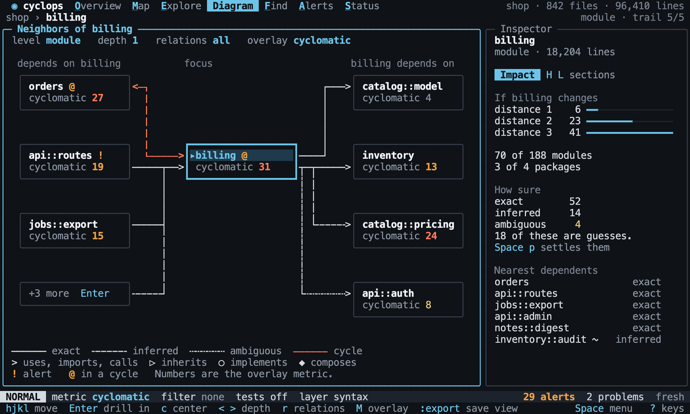
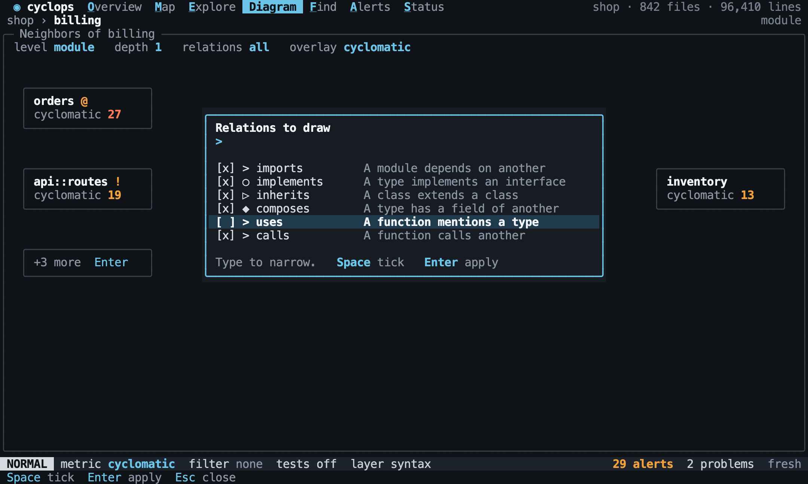
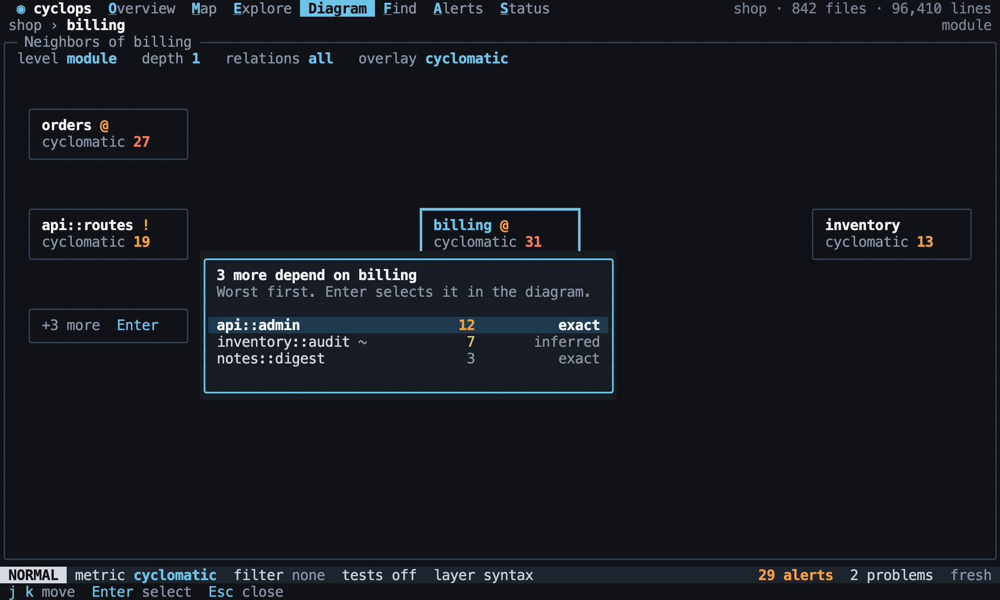
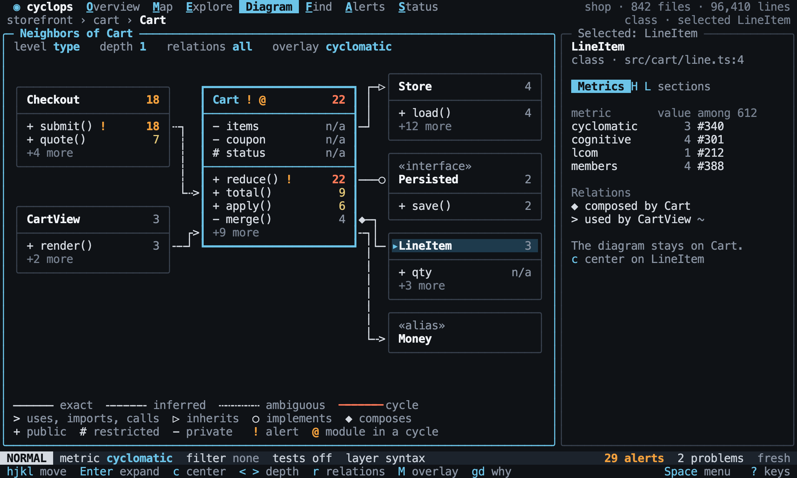

# Diagram

Back to the [terminal interface](README.md).

The diagram draws [what the core describes](../explore/diagrams.md): structure with
metrics attached. A whole project cannot be read in a terminal, so it always starts
from the focus, with what depends on it on one side and what it depends on on the other.

## What it shows

The focus decides the level. A project shows its modules, or its packages when it has
several. A module shows its neighbors, and `Enter` drills in. On a type, `Enter` expands its [class box](#class-boxes) instead.
Drilling in shows what is inside at depth 0, `>` then adds its
neighbors, and `-` goes back up to the depth you had. `nodes?` lists what is shown.

[//]: # "import Spec.Fixtures"
[//]: # "decisionTable Tui"

| # situation    | workspace | keys                                  | level? | depth? | nodes?                                                           |
| -------------- | --------- | ------------------------------------- | ------ | ------ | ---------------------------------------------------------------- |
| A project      | rust-shop | `<Space>d`                            | module | 1      | shop::billing, shop::catalog, shop::notes, shop::orders          |
| A module       | rust-shop | `<Space>ejj<Space>d`                  | module | 1      | shop::billing, shop::catalog, shop::orders                       |
| No relations   | rust-shop | `<Space>eG<Space>d`                   | module | 1      | shop::notes                                                      |
| Drilling in    | rust-shop | `<Space>ej<Space>d<CR>`               | type   | 0      | shop::orders::Order                                              |
| A type         | rust-shop | `<C-p>Order<CR><Space>d<CR>`          | type   | 1      | shop::billing::Invoice, shop::catalog::Item, shop::orders::Order |
| Back up        | rust-shop | `<Space>ej<Space>d<CR>-`              | module | 1      | shop::billing, shop::catalog, shop::orders                       |
| Then neighbors | rust-shop | `<Space>ej<Space>d<CR>rcomposes<CR>>` | type   | 1      | shop::billing::Invoice, shop::orders::Order                      |

[//]: # "decisionTable Tui"

| # situation | workspace   | keys       | level?  | depth? | nodes?                               |
| ----------- | ----------- | ---------- | ------- | ------ | ------------------------------------ |
| A workspace | rust-crates | `<Space>d` | package | 1      | c01, c02, c03, c04, c05, c06, engine |

`<` and `>` change the depth, and it never goes below 0.

[//]: # "decisionTable Tui"

| # situation | workspace | keys                        | depth? | nodes?       |
| ----------- | --------- | --------------------------- | ------ | ------------ |
| Less        | rust-shop | `<Space>ej<Space>d<lt>`     | 0      | shop::orders |
| Not below   | rust-shop | `<Space>ej<Space>d<lt><lt>` | 0      | shop::orders |
| More        | rust-shop | `<Space>eG<Space>d>`        | 2      | shop::notes  |

`hjkl` move between nodes. The focus does not move until you ask: `c` centers the
diagram on the selected node.

[//]: # "decisionTable Tui"

| # situation | workspace | keys                                             | focus?        | selected?     |
| ----------- | --------- | ------------------------------------------------ | ------------- | ------------- |
| Selecting   | rust-shop | `<Space>ej<Space>d<click symbol shop::catalog>`  | shop::orders  | shop::catalog |
| With a key  | rust-shop | `<Space>ej<Space>dl`                             | shop::orders  | shop::billing |
| Centering   | rust-shop | `<Space>ej<Space>d<click symbol shop::catalog>c` | shop::catalog | shop::catalog |

`r` picks which [relation kinds](../model/relations.md) are drawn, in the order of that page.
Typing narrows the list, and `Enter` picks one. `Space` toggles the entry under the cursor
instead, and `Enter` then applies what is ticked. The default is all of them.

[//]: # "decisionTable Tui"

| # situation | workspace | keys                   | popup?          | relations?                                  |
| ----------- | --------- | ---------------------- | --------------- | ------------------------------------------- |
| The default | rust-shop | `<Space>d`             | none            | all                                         |
| The picker  | rust-shop | `<Space>dr`            | relation picker | all                                         |
| Only one    | rust-shop | `<Space>drimports<CR>` | none            | imports                                     |
| Toggling    | rust-shop | `<Space>dr<Space><CR>` | none            | implements, inherits, composes, uses, calls |

A column that cannot fit collapses into a `+N more` node, so a large project stays
readable. `Enter` on it lists the rest, as a popup. Choosing one selects it, and it takes
the place of the last node in the column, so that what is selected is always on screen.
[`rust-wide`](../../samples/rust-wide) has a `hub` module with twelve modules depending on it.

[//]: # "decisionTable Tui"

| # situation  | workspace | size   | keys                               | popup?     | text      | includes? | other text | other includes? |
| ------------ | --------- | ------ | ---------------------------------- | ---------- | --------- | --------- | ---------- | --------------- |
| Too many     | rust-wide | 80x24  | `<C-p>hub<CR><Space>d`             | none       | more      | yes       |            |                 |
| Opening it   | rust-wide | 80x24  | `<C-p>hub<CR><Space>d<click more>` | more nodes | wide::m12 | yes       |            |                 |
| Room for all | rust-wide | 200x80 | `<C-p>hub<CR><Space>d`             | none       | wide::m12 | yes       | more       | no              |

[//]: # "decisionTable Tui"

| # situation  | workspace | size  | keys                                                     | popup? | selected? | text      | includes? |
| ------------ | --------- | ----- | -------------------------------------------------------- | ------ | --------- | --------- | --------- |
| Choosing one | rust-wide | 80x24 | `<C-p>hub<CR><Space>d<click more><click menu wide::m12>` | none   | wide::m12 | wide::m12 | yes       |

## Reading it

Each node prints the current metric, and a metric that does not apply shows `n/a`. A
node shows `!` for an alert and `@` for a cycle. Line style shows
[confidence](../model/relations.md), as the [design](design/README.md#glyphs) sets out,
and the legend stays on screen. `node value?` reads the `subject` node.

[//]: # "decisionTable Tui"

| # situation    | workspace | keys                       | subject      | node value? |
| -------------- | --------- | -------------------------- | ------------ | ----------- |
| The metric     | rust-shop | `<Space>d`                 | shop::orders | 3           |
| Another one    | rust-shop | `<Space>dMinstability<CR>` | shop::orders | 1.00        |
| Does not apply | rust-shop | `<Space>dMlcom<CR>`        | shop::orders | n/a         |

[//]: # "decisionTable Tui"

| # situation | workspace   | steps                                       | keys                 | subject      | marks? |
| ----------- | ----------- | ------------------------------------------- | -------------------- | ------------ | ------ |
| An alert    | rust-shop   | `add alert instability module >= 1 warning` | `<Space>d`           | shop::orders | !      |
| A cycle     | rust-cycles |                                             | `<Space>d`           | cycles::a    | @      |
| Next to one | rust-cycles |                                             | `<Space>d`           | cycles::f    | none   |
| A class box | rust-cycles |                                             | `<C-p>A<CR><Space>d` | cycles::a::A | @      |

[//]: # "decisionTable Tui"

| # situation | workspace | keys       | text       | includes? |
| ----------- | --------- | ---------- | ---------- | --------- |
| The legend  | rust-shop | `<Space>d` | ambiguous  | yes       |
| The kinds   | rust-shop | `<Space>d` | implements | yes       |

A filter keeps a node whole, so the diagram says how much it left out.

[//]: # "decisionTable Tui"

| # situation | workspace | keys                           | text         | includes? |
| ----------- | --------- | ------------------------------ | ------------ | --------- |
| Filtered    | rust-shop | `fpath ~ "src/o*"<CR><Space>d` | 1 of 4 nodes | yes       |

## Class boxes

At type level a node is a class box, as the [design](design/README.md#class-boxes) sets out:
its name, then its fields, then its methods, with the overlay metric on each member. A
large type shows only its worst members, and `+N more` for the rest.

`Enter` expands the selected box to show every member, and `-` collapses it. Inside an
expanded box, `j` and `k` move through its members and stop at its ends, and `h` and `l`
leave it for the next node. Whatever acts on the selection acts on a member, except `c`,
which centers the diagram on the member's type. The interface has no separate member level. `member` stays in the
[core](../explore/diagrams.md#levels), for `cyclops export`.

[//]: # "decisionTable Tui"

| # situation  | workspace | keys                             | level? | selected?                     | text        | includes? |
| ------------ | --------- | -------------------------------- | ------ | ----------------------------- | ----------- | --------- |
| Expanded     | rust-shop | `<C-p>Order<CR><Space>d<CR>`     | type   | shop::orders::Order           | invoices    | yes       |
| A field      | rust-shop | `<C-p>Order<CR><Space>d<CR>j`    | type   | shop::orders::Order::invoices | invoices    | yes       |
| A method     | rust-shop | `<C-p>Order<CR><Space>d<CR>jj`   | type   | shop::orders::Order::total    | total()     | yes       |
| Collapsed    | rust-shop | `<C-p>Order<CR><Space>d<CR>-`    | type   | shop::orders::Order           | Order       | yes       |
| At the end   | rust-shop | `<C-p>Order<CR><Space>d<CR>jjjj` | type   | shop::orders::Order::add      | add()       | yes       |
| Leaving it   | rust-shop | `<C-p>Order<CR><Space>d<CR>jl`   | type   | shop::billing::Invoice        | Invoice     | yes       |
| A stereotype | rust-shop | `<C-p>Priced<CR><Space>d`        | type   | shop::catalog::Priced         | «interface» | yes       |

[//]: # "decisionTable Tui"

| # situation | workspace | keys                             | view?   | focus?                     | section? |
| ----------- | --------- | -------------------------------- | ------- | -------------------------- | -------- |
| Why         | rust-shop | `<C-p>Order<CR><Space>d<CR>jjgd` | Explore | shop::orders::Order::total | Why      |

[//]: # "decisionTable Tui"

| # situation        | workspace | keys                                                                  | focus?                 | selected?                     |
| ------------------ | --------- | --------------------------------------------------------------------- | ---------------------- | ----------------------------- |
| Another box        | rust-shop | `<C-p>Order<CR><Space>d<click symbol shop::billing::Invoice><CR>`     | shop::orders::Order    | shop::billing::Invoice        |
| Centering a member | rust-shop | `<C-p>Order<CR><Space>d<click symbol shop::billing::Invoice::total>c` | shop::billing::Invoice | shop::billing::Invoice::total |

`member value?` reads the overlay on the `subject` member, and `marks?` reads its marks.

[//]: # "decisionTable Tui"

| # situation | workspace | steps                                       | keys                     | subject                       | member value? | marks? |
| ----------- | --------- | ------------------------------------------- | ------------------------ | ----------------------------- | ------------- | ------ |
| A method    | rust-shop |                                             | `<C-p>Order<CR><Space>d` | shop::orders::Order::total    | 3             | none   |
| A field     | rust-shop |                                             | `<C-p>Order<CR><Space>d` | shop::orders::Order::invoices | n/a           | none   |
| An alert    | rust-shop | `add alert cyclomatic function > 2 warning` | `<C-p>Order<CR><Space>d` | shop::orders::Order::total    | 3             | !      |

## Cycles

`]c` and `[c` move the focus through the [cycles](../metrics/dependency-cycles.md). They work
from any view, and go to Diagram if the view cannot show them.

[//]: # "decisionTable Tui"

| # situation | workspace   | keys   | view?    | focus?    | text                 | includes? |
| ----------- | ----------- | ------ | -------- | --------- | -------------------- | --------- |
| The first   | rust-cycles | `]c`   | Diagram  | cycles::a | Neighbors of a       | yes       |
| The second  | rust-cycles | `]c]c` | Diagram  | cycles::c | Neighbors of c       | yes       |
| Back        | rust-cycles | `]c[c` | Diagram  | cycles::c | Neighbors of c       | yes       |
| None        | rust-shop   | `]c`   | Overview | shop      | No dependency cycles | yes       |

## Impact

`gr` answers "what would changing this affect?". It opens the diagram on the selection,
with the inspector on [Impact](../explore/impact.md). It shows the dependents at each
distance, how many modules and packages they reach, and how many of those are guesses.

[//]: # "decisionTable Tui"

| # situation | workspace | steps              | keys                        | view?   | section? | text                     | includes? |
| ----------- | --------- | ------------------ | --------------------------- | ------- | -------- | ------------------------ | --------- |
| Opening     | rust-shop |                    | `<C-p>catalog<CR>gr`        | Diagram | Impact   | distance 1               | yes       |
| The reach   | rust-shop |                    | `<C-p>catalog<CR>gr`        | Diagram | Impact   | 2 of 4 modules           | yes       |
| Nothing     | rust-shop |                    | `<C-p>notes<CR>gr`          | Diagram | Impact   | Nothing depends on this. | yes       |
| Guesses     | rust-shop |                    | `<C-p>Invoice::total<CR>gr` | Diagram | Impact   | 1 of these is a guess.   | yes       |
| None left   | rust-shop | `precise analysis` | `<C-p>Invoice::total<CR>gr` | Diagram | Impact   | exact                    | yes       |

## Exporting

`Space x` starts the `:export` command for the current view, which writes the same
output as [`cyclops export`](../cli/commands.md#exporting), with the current focus, depth,
level and overlay. So a diagram of types exports as a
[class diagram](../cli/commands.md#class-diagrams). A format it does not know is refused.
`exported text` and `exported includes?` read the file.

[//]: # "decisionTable Tui"

| # situation    | workspace | keys                                  | mode?   | created? | text                  | includes? |
| -------------- | --------- | ------------------------------------- | ------- | -------- | --------------------- | --------- |
| The prompt     | rust-shop | `<Space>d<Space>x`                    | COMMAND | none     | :export               | yes       |
| Writing        | rust-shop | `<Space>d:export mermaid out.mmd<CR>` | NORMAL  | out.mmd  | out.mmd               | yes       |
| Unknown format | rust-shop | `<Space>d:export visio out<CR>`       | NORMAL  | none     | Unknown format: visio | yes       |

[//]: # "decisionTable Tui"

| # situation     | workspace | keys                                                | created? | exported text | exported includes? |
| --------------- | --------- | --------------------------------------------------- | -------- | ------------- | ------------------ |
| A class diagram | rust-shop | `<C-p>Order<CR><Space>d:export mermaid out.mmd<CR>` | out.mmd  | classDiagram  | yes                |
| With its scores | rust-shop | `<C-p>Order<CR><Space>d:export mermaid out.mmd<CR>` | out.mmd  | cyclomatic 3  | yes                |
