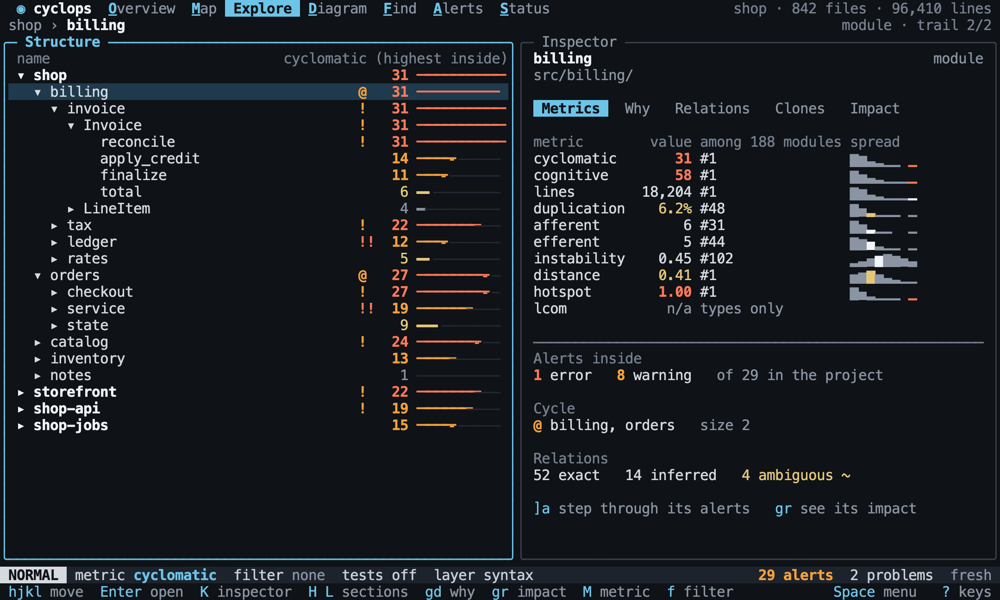

# Explore

Back to the [terminal interface](README.md).

Explore shows the project as a tree with the current metric beside every row, so that
structure and quality are read together. The inspector beside it answers "is this
part better or worse than the rest?".

## The tree

Each level is sorted by the current metric, worst first. Ties are alphabetical, and
rows with no value go last. So the worst part of the project is always at the top of
each branch. `rows?` lists the rows in order.

[//]: # "import Spec.Fixtures"
[//]: # "decisionTable Tui -- snooze until 2099-12-31"

| # situation    | workspace | keys                       | rows?                                                                                                                                                                   |
| -------------- | --------- | -------------------------- | ----------------------------------------------------------------------------------------------------------------------------------------------------------------------- |
| Worst first    | rust-shop | `<Space>e`                 | shop, shop::orders, shop::billing, shop::catalog, shop::notes                                                                                                           |
| Another metric | rust-shop | `<Space>eMinstability<CR>` | shop, shop::orders, shop::billing, shop::catalog, shop::notes                                                                                                           |
| No values      | rust-shop | `<Space>eMlcom<CR>`        | shop, shop::billing, shop::catalog, shop::notes, shop::orders                                                                                                           |
| Opening        | rust-shop | `<Space>ejl`               | shop, shop::orders, shop::orders::Order, shop::billing, shop::catalog, shop::notes                                                                                      |
| With `Enter`   | rust-shop | `<Space>ej<CR>`            | shop, shop::orders, shop::orders::Order, shop::billing, shop::catalog, shop::notes                                                                                      |
| Members        | rust-shop | `<Space>ejljl`             | shop, shop::orders, shop::orders::Order, shop::orders::Order::total, shop::orders::Order::add, shop::orders::Order::invoices, shop::billing, shop::catalog, shop::notes |
| Closing        | rust-shop | `<Space>ejlh`              | shop, shop::orders, shop::billing, shop::catalog, shop::notes                                                                                                           |
| A fold         | rust-shop | `<Space>ejzaza`            | shop, shop::orders, shop::billing, shop::catalog, shop::notes                                                                                                           |
| Closing all    | rust-shop | `<Space>ezM`               | shop                                                                                                                                                                    |

`h` on a closed row moves to its parent. `zR` opens everything, and a row has no arrow
when there is nothing inside it.

[//]: # "decisionTable Tui -- snooze until 2099-12-31"

| # situation     | workspace | keys          | selected? | text    | includes? |
| --------------- | --------- | ------------- | --------- | ------- | --------- |
| To the parent   | rust-shop | `<Space>ejh`  | shop      | shop    | yes       |
| Then up         | rust-shop | `<Space>ejhh` | shop      | shop    | yes       |
| Open everything | rust-shop | `<Space>ezR`  | shop      | is_free | yes       |

## Marks

A row shows `!` when it or anything inside it has a warning, `!!` when it has an
error, and `@` when it is in a cycle. Rollups do the same, so the path to a problem
is visible from the top of the tree.

[//]: # "decisionTable Tui -- snooze until 2099-12-31"

| # situation     | workspace   | steps                                                                                | subject       | marks? |
| --------------- | ----------- | ------------------------------------------------------------------------------------ | ------------- | ------ |
| On the symbol   | rust-shop   | `add alert instability module >= 1 warning`                                          | shop::orders  | !      |
| Inside it       | rust-shop   | `add alert cyclomatic function > 2 warning`                                          | shop::orders  | !      |
| An error wins   | rust-shop   | `add alert cyclomatic function > 2 warning; add alert instability module >= 1 error` | shop::orders  | !!     |
| Up to the top   | rust-shop   | `add alert cyclomatic function > 2 warning`                                          | shop          | !      |
| Elsewhere       | rust-shop   | `add alert cyclomatic function > 2 warning`                                          | shop::billing | none   |
| In a cycle      | rust-cycles |                                                                                      | cycles::a     | @      |
| Next to a cycle | rust-cycles |                                                                                      | cycles::f     | none   |

## The inspector

`K` opens and closes the inspector, in any view. It always shows the selection. `H` and `L`
move through its sections, which wrap around. `section?` is the open section, and
`closed` means there is no inspector.

[//]: # "decisionTable Tui -- snooze until 2099-12-31"

| # situation  | workspace | keys            | section?  | text      | includes? |
| ------------ | --------- | --------------- | --------- | --------- | --------- |
| Closed       | rust-shop | `<Space>e`      | closed    | Structure | yes       |
| Open         | rust-shop | `<Space>eK`     | Metrics   | Inspector | yes       |
| Closed again | rust-shop | `<Space>eKK`    | closed    | Structure | yes       |
| The next     | rust-shop | `<Space>eKL`    | Why       | Inspector | yes       |
| The third    | rust-shop | `<Space>eKLL`   | Relations | Inspector | yes       |
| The fourth   | rust-shop | `<Space>eKLLL`  | Clones    | Inspector | yes       |
| The fifth    | rust-shop | `<Space>eKLLLL` | Impact    | Inspector | yes       |
| Wraps        | rust-shop | `<Space>eKH`    | Impact    | Inspector | yes       |
| In a diagram | rust-shop | `<Space>dK`     | Metrics   | Inspector | yes       |

It stays open and follows the selection.

[//]: # "decisionTable Tui -- snooze until 2099-12-31"

| # situation  | workspace | keys                 | section? | inspecting?  |
| ------------ | --------- | -------------------- | -------- | ------------ |
| Following    | rust-shop | `<Space>eKj`         | Metrics  | shop::orders |
| Across views | rust-shop | `<Space>eKj<Space>d` | Metrics  | shop::orders |

### Metrics

Metrics shows each metric that applies, with its [rank and spread](../explore/ranking.md)
among its peers. That comparison is what answers how this part stands against the
rest. A metric with no value shows `n/a`. There is no total.

[//]: # "decisionTable Tui -- snooze until 2099-12-31"

| # situation    | workspace | keys                     | text    | includes? |
| -------------- | --------- | ------------------------ | ------- | --------- |
| A rank         | rust-shop | `<C-p>Order::total<CR>K` | #1 of 6 | yes       |
| A module       | rust-shop | `<Space>ejK`             | #1 of 4 | yes       |
| Does not apply | rust-shop | `<Space>ejK`             | n/a     | yes       |

[//]: # "decisionTable Tui -- snooze until 2099-12-31"

| # situation | workspace   | steps                                       | keys                     | text      | includes? |
| ----------- | ----------- | ------------------------------------------- | ------------------------ | --------- | --------- |
| Its alerts  | rust-shop   | `add alert cyclomatic function > 2 warning` | `<Space>ejK`             | 1 warning | yes       |
| Its cycle   | rust-cycles |                                             | `<C-p>cycles::a<CR>K`    | size 2    | yes       |
| Confidence  | rust-shop   |                                             | `<C-p>Order::total<CR>K` | ambiguous | yes       |

### Relations

Relations lists what the focus uses and what uses it. Each one shows its kind and its
confidence. `Enter` jumps to it.

[//]: # "decisionTable Tui -- snooze until 2099-12-31"

| # situation | workspace | keys                                 | focus?                          | text      | includes? |
| ----------- | --------- | ------------------------------------ | ------------------------------- | --------- | --------- |
| Listing     | rust-shop | `<C-p>Order::total<CR>KLL`           | shop::orders::Order::total      | calls     | yes       |
| A guess     | rust-shop | `<C-p>Order::total<CR>KLL`           | shop::orders::Order::total      | ambiguous | yes       |
| Jumping     | rust-shop | `<C-p>Order::total<CR>KLL<C-w>l<CR>` | shop::billing::Invoice::is_free | is_free   | yes       |

### Clones

`gc` opens the clones of the focus. `]d` and `[d` step through the symbols that have
[copies](../metrics/duplication.md).

[//]: # "decisionTable Tui -- snooze until 2099-12-31"

| # situation | workspace | keys               | section? | text          | includes? |
| ----------- | --------- | ------------------ | -------- | ------------- | --------- |
| Clones      | clones    | `<C-p>first<CR>gc` | Clones   | src/second.rs | yes       |
| None        | rust-shop | `<Space>ejgc`      | Clones   | No clones.    | yes       |

## Opening the editor

`gf` opens the focus in `$VISUAL`, or `$EDITOR`, at its line, and comes back when the
editor closes. Without either, it says so. `opened?` is the file and line.

[//]: # "decisionTable Tui -- snooze until 2099-12-31"

| # situation | workspace | steps             | keys                      | opened?          | text                       | includes? |
| ----------- | --------- | ----------------- | ------------------------- | ---------------- | -------------------------- | --------- |
| A function  | rust-shop | `env EDITOR fake` | `<C-p>Order::total<CR>gf` | src/orders.rs:13 | Structure                  | yes       |
| A module    | rust-shop | `env EDITOR fake` | `<Space>ejgf`             | src/orders.rs:1  | Structure                  | yes       |
| No editor   | rust-shop |                   | `<Space>ejgf`             | none             | Set $EDITOR to open files. | yes       |
