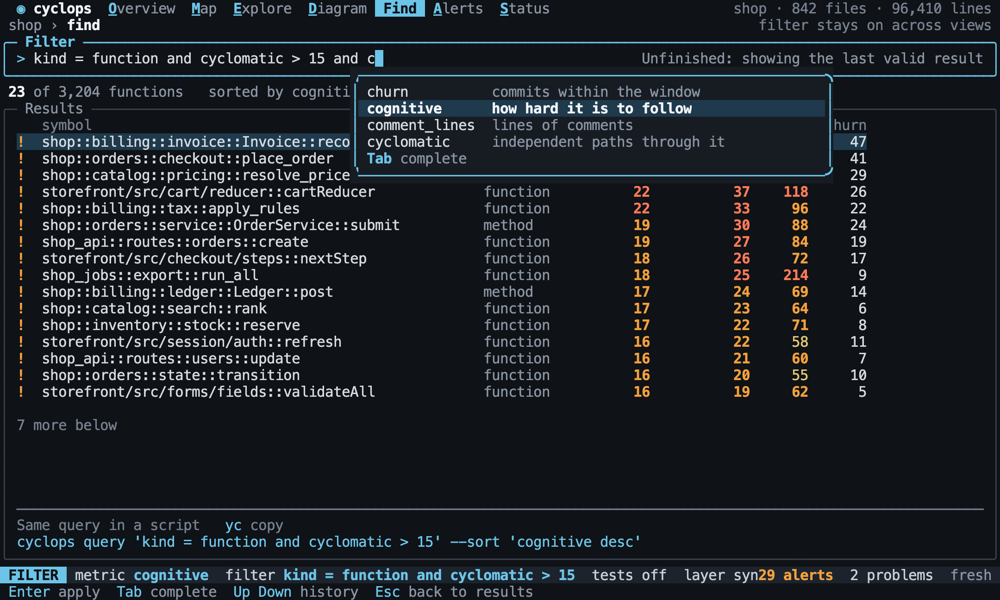

# Find

Back to the [terminal interface](README.md).

Find ranks anything by any metric, using the [filter language](../explore/filters.md). It
is the shortest way from a question to a list of symbols, and a result can be opened
in any other view.

## Results

Find lists the symbols that pass the filter, sorted by the current metric, worst
first. Ties stay alphabetical, and symbols with no value go last, as on the
[filters](../explore/filters.md#sorting-and-limiting) page. `rows?` lists them in order.

[//]: # "import Spec.Fixtures"
[//]: # "decisionTable Tui -- snooze until 2099-12-31"

| # situation     | workspace | keys                                            | rows?                                                            |
| --------------- | --------- | ----------------------------------------------- | ---------------------------------------------------------------- |
| Filtered        | rust-shop | `<Space>ffkind = method and cyclomatic > 1<CR>` | shop::orders::Order::total, shop::billing::Invoice::total        |
| Types           | rust-shop | `<Space>ffkind = struct<CR>`                    | shop::orders::Order, shop::billing::Invoice, shop::catalog::Item |
| Nothing matches | rust-shop | `<Space>ffcyclomatic > 99<CR>`                  | none                                                             |

Without a filter, Find lists every symbol that has a value for the metric.

[//]: # "decisionTable Tui -- snooze until 2099-12-31"

| # situation | workspace | keys                       | count? |
| ----------- | --------- | -------------------------- | ------ |
| Everything  | rust-shop | `<Space>fMinstability<CR>` | 3      |

## Writing a filter

Results update as you type, and the filter is checked as you type. While it cannot be
understood, the last good results stay and the reason shows beside the prompt. `Tab`
completes metrics, properties and values, from a list that names each one.

[//]: # "decisionTable Tui -- snooze until 2099-12-31"

| # situation | workspace | keys                                     | mode?  | filter?       | count? | text                                     | includes? |
| ----------- | --------- | ---------------------------------------- | ------ | ------------- | ------ | ---------------------------------------- | --------- |
| Live        | rust-shop | `<Space>ffkind = struct`                 | FILTER | none          | 3      | 3 of                                     | yes       |
| Unfinished  | rust-shop | `<Space>ffkind = struct<CR>f<C-u>kind =` | FILTER | kind = struct | 3      | Invalid filter: expected a value after = | yes       |

[//]: # "decisionTable Tui -- snooze until 2099-12-31"

| # situation  | workspace | keys                     | mode?  | text                 | includes? |
| ------------ | --------- | ------------------------ | ------ | -------------------- | --------- |
| A completion | rust-shop | `<Space>ffcog<Tab>`      | FILTER | cognitive            | yes       |
| Unknown kind | rust-shop | `<Space>ffkind = widget` | FILTER | Unknown kind: widget | yes       |

`completions?` lists what `Tab` offers, each with a description.

[//]: # "decisionTable Tui -- snooze until 2099-12-31"

| # situation | workspace | keys               | completions?     |
| ----------- | --------- | ------------------ | ---------------- |
| A metric    | rust-shop | `<Space>ffcog`     | cognitive        |
| A value     | rust-shop | `<Space>ffrole = ` | production, test |

`Up` and `Down` step through the filters used in this session.

[//]: # "decisionTable Tui -- snooze until 2099-12-31"

| # situation | workspace | keys                                   | filter?       |
| ----------- | --------- | -------------------------------------- | ------------- |
| Going back  | rust-shop | `<Space>ffkind = struct<CR>Ff<Up><CR>` | kind = struct |

## Sorting

`s` picks a column to sort by, and picking the same column again turns the order
around. Clicking a column does the same. `sorted by?` reads the current order.

[//]: # "decisionTable Tui -- snooze until 2099-12-31"

| # situation  | workspace | keys                               | sorted by?      | metric?    |
| ------------ | --------- | ---------------------------------- | --------------- | ---------- |
| The default  | rust-shop | `<Space>f`                         | cyclomatic desc | cyclomatic |
| A new one    | rust-shop | `<Space>fslines<CR>`               | lines desc      | lines      |
| Turning over | rust-shop | `<Space>fscyclomatic<CR>`          | cyclomatic asc  | cyclomatic |
| By mouse     | rust-shop | `<Space>f<click column cognitive>` | cognitive desc  | cognitive  |

Sorting by a metric makes it the metric of the lens, so the choice carries to other
views.

## Going from a result

`Enter` opens a result in Explore. The filter stays on, so the result stays in context.

[//]: # "decisionTable Tui -- snooze until 2099-12-31"

| # situation | workspace | keys                             | view?   | focus?                     | filter?       |
| ----------- | --------- | -------------------------------- | ------- | -------------------------- | ------------- |
| Opening     | rust-shop | `<Space>ffkind = method<CR><CR>` | Explore | shop::orders::Order::total | kind = method |
| To why      | rust-shop | `<Space>ffkind = method<CR>gd`   | Explore | shop::orders::Order::total | kind = method |

## Copying

`yy` copies the selected symbol, `yf` copies the filter, and `yc` copies the whole search
as a [`cyclops query`](../cli/commands.md#querying) command, so that an answer found here
can go into a script.

[//]: # "decisionTable Tui -- snooze until 2099-12-31"

| # situation | workspace | keys                           | clipboard?                                             |
| ----------- | --------- | ------------------------------ | ------------------------------------------------------ |
| The symbol  | rust-shop | `<Space>ffkind = method<CR>yy` | shop::orders::Order::total                             |
| The filter  | rust-shop | `<Space>ffkind = method<CR>yf` | kind = method                                          |
| The command | rust-shop | `<Space>ffkind = method<CR>yc` | cyclops query 'kind = method' --sort 'cyclomatic desc' |
