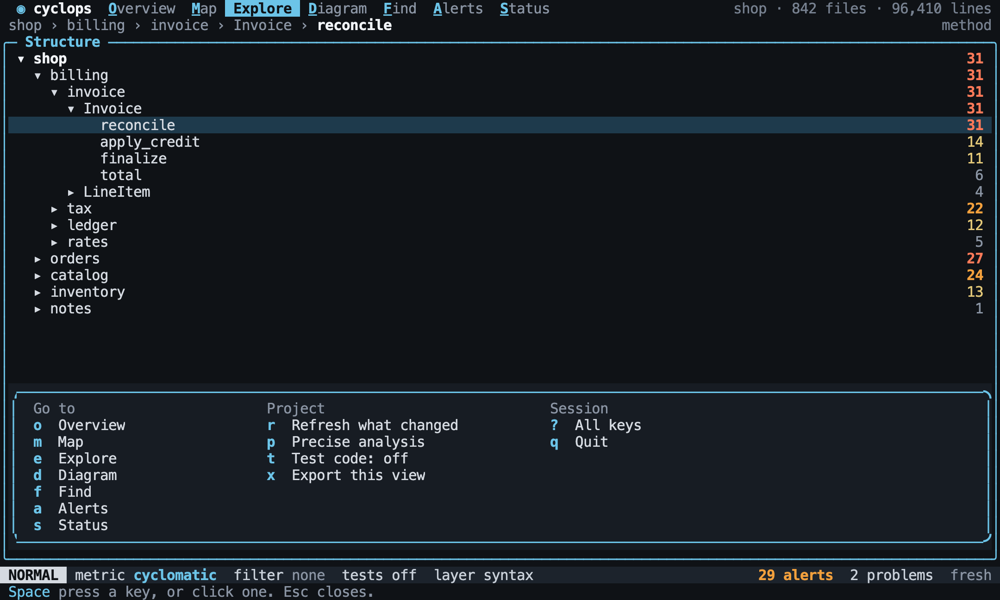

# Keys

Back to the [terminal interface](README.md).

Keys follow Vim. If a Vim user would guess a key, that guess should work. Other pages
test what each key does, and this page is the map of them all. The one exception is
`Ctrl-n` for going forward on the trail: most terminals send `Ctrl-i` and `Tab` as the same
key, and `Tab` moves between panes.

| Keys                     | Meaning                                     | Tested in                   |
| ------------------------ | ------------------------------------------- | --------------------------- |
| `h` `j` `k` `l`          | Left, down, up, right                       | [Navigation](navigation.md) |
| `gg` `G`                 | First, last                                 | [Navigation](navigation.md) |
| `Ctrl-d` `Ctrl-u`        | Half a page down, up                        | [Navigation](navigation.md) |
| `Enter`                  | Open, drill in, or expand a class box       | [Navigation](navigation.md) |
| `-`                      | Go up a level                               | [Navigation](navigation.md) |
| `za` `zR` `zM`           | Fold, open all, close all                   | [Explore](explore.md)       |
| `Tab`                    | Next pane                                   | [Navigation](navigation.md) |
| `Ctrl-w` `h` `j` `k` `l` | Move between panes                          | [Navigation](navigation.md) |
| `gt` `gT`                | Next, previous view                         | [The shell](shell.md)       |
| `gd`                     | Why: source and reasons                     | [Why](why.md)               |
| `gr`                     | Impact: what depends on it                  | [Diagram](diagram.md)       |
| `gc`                     | Clones of it                                | [Explore](explore.md)       |
| `gf`                     | Open in the editor                          | [Explore](explore.md)       |
| `Ctrl-o` `Ctrl-n`        | Back, forward on the trail                  | [Navigation](navigation.md) |
| `m{a-z}` `'{a-z}`        | Mark this symbol, jump to a mark            | [Navigation](navigation.md) |
| `Ctrl-p`                 | Jump to any symbol                          | [Navigation](navigation.md) |
| `/` `n` `N`              | Search this view, next, previous            | [Navigation](navigation.md) |
| `M` `]m` `[m`            | Pick a metric, next, previous               | [The lens](lens.md)         |
| `f` `F`                  | Edit the filter, clear it                   | [The lens](lens.md)         |
| `K` `H` `L`              | Inspector on or off, previous, next section | [Explore](explore.md)       |
| `]a` `[a`                | Next, previous alert                        | [Alerts](alerts.md)         |
| `]c` `[c`                | Next, previous cycle                        | [Diagram](diagram.md)       |
| `]d` `[d`                | Next, previous clone                        | [Explore](explore.md)       |
| `]p` `[p`                | Next, previous problem                      | [Status](status.md)         |
| `<` `>` `c` `r`          | Diagram: depth, center, relations           | [Diagram](diagram.md)       |
| `s`                      | Find: sort by a column                      | [Find](find.md)             |
| `e` `x` `v`              | Alerts: edit, disable, group                | [Alerts](alerts.md)         |
| `A`                      | New alert from here                         | [Alerts](alerts.md)         |
| `yy` `yf` `yc`           | Copy symbol, filter, CLI command            | [Find](find.md)             |
| `:`                      | Command line                                | This page                   |
| `?`                      | Keys for this view                          | This page                   |
| `q`                      | Close a pane or popup                       | [The shell](shell.md)       |
| `Esc`                    | Cancel                                      | [The shell](shell.md)       |

## The Space menu

`Space` is the leader. It opens a menu of what can come next straight away, with no
delay. The menu holds what applies to the whole project. Keys that act on one symbol
stay outside it. Each entry can also be clicked.

| Key | Group   | Action               |
| --- | ------- | -------------------- |
| `o` | Go to   | Overview             |
| `m` | Go to   | Map                  |
| `e` | Go to   | Explore              |
| `d` | Go to   | Diagram              |
| `f` | Go to   | Find                 |
| `a` | Go to   | Alerts               |
| `s` | Go to   | Status               |
| `r` | Project | Refresh what changed |
| `p` | Project | Precise analysis     |
| `t` | Project | Test code on or off  |
| `x` | Project | Export this view     |
| `?` | Session | All keys             |
| `q` | Session | Quit                 |

[//]: # "import Spec.Fixtures"
[//]: # "decisionTable Tui"

| # situation        | workspace | keys                          | popup?     | popup keys?                           | view?    | mode?  |
| ------------------ | --------- | ----------------------------- | ---------- | ------------------------------------- | -------- | ------ |
| Opens at once      | rust-shop | `<Space>`                     | space menu | ?, a, d, e, f, m, o, p, q, r, s, t, x | Overview | NORMAL |
| A key runs         | rust-shop | `<Space>d`                    | none       | none                                  | Diagram  | NORMAL |
| Esc closes         | rust-shop | `<Space><Esc>`                | none       | none                                  | Overview | NORMAL |
| Space closes       | rust-shop | `<Space><Space>`              | none       | none                                  | Overview | NORMAL |
| Another key closes | rust-shop | `<Space>z`                    | none       | none                                  | Overview | NORMAL |
| Clicking an entry  | rust-shop | `<Space><click menu Diagram>` | none       | none                                  | Diagram  | NORMAL |
| In a prompt        | rust-shop | `f<Space>`                    | none       | none                                  | Overview | FILTER |

The menu shows the current test code setting, so it says what the key will change.

[//]: # "decisionTable Tui"

| # situation | workspace | steps                    | keys      | text           | includes? |
| ----------- | --------- | ------------------------ | --------- | -------------- | --------- |
| Off         | rust-shop |                          | `<Space>` | Test code: off | yes       |
| On          | rust-shop | `set tests.include true` | `<Space>` | Test code: on  | yes       |

## Other prefixes

`g`, `z`, `]` and `[` wait for a second key. If it does not come within half a second,
a popup lists what can follow. Typing quickly never shows it.

[//]: # "decisionTable Tui"

| # situation   | workspace | keys           | popup?    | popup keys?         |
| ------------- | --------- | -------------- | --------- | ------------------- |
| Fast          | rust-shop | `g`            | none      | none                |
| After a pause | rust-shop | `g<wait 600>`  | key hints | T, c, d, f, g, r, t |
| Square        | rust-shop | `]<wait 600>`  | key hints | a, c, d, m, p       |
| Then the key  | rust-shop | `g<wait 600>t` | none      | none                |

## Counts

A number before a motion repeats it. Views sit behind the Space menu so that numbers
stay free for this.

[//]: # "decisionTable Tui"

| # situation  | workspace | keys         | selected?     |
| ------------ | --------- | ------------ | ------------- |
| One          | rust-shop | `<Space>ej`  | shop::orders  |
| Three        | rust-shop | `<Space>e3j` | shop::catalog |
| Past the end | rust-shop | `<Space>e9j` | shop::notes   |

## The command line

`:` opens the command line. Commands complete with `Tab`. An unknown command says so
and changes nothing.

| Command               | Meaning                              |
| --------------------- | ------------------------------------ |
| `:q`                  | Quit, or leave a rule without saving |
| `:w`                  | Save the rule being edited           |
| `:w user`             | Save it to your own file             |
| `:init`               | Save default settings for the team   |
| `:export FORMAT PATH` | Export this view to a file           |
| `:set bg=VALUE`       | Set the [theme](themes.md)           |
| `:help`               | All keys                             |

[//]: # "decisionTable Tui"

| # situation     | workspace | keys            | mode?   | text                      | includes? | created?             |
| --------------- | --------- | --------------- | ------- | ------------------------- | --------- | -------------------- |
| Unknown         | rust-shop | `:nonsense<CR>` | NORMAL  | Unknown command: nonsense | yes       | none                 |
| Completion      | rust-shop | `:exp<Tab>`     | COMMAND | :export                   | yes       | none                 |
| Saving settings | rust-shop | `:init<CR>`     | NORMAL  | none                      | yes       | .cyclops/config.toml |

## Help

`?` opens the keys for the current view, and `Space ?` opens them all.

[//]: # "decisionTable Tui"

| # situation | workspace | keys        | popup? | text         | includes? |
| ----------- | --------- | ----------- | ------ | ------------ | --------- |
| This view   | rust-shop | `<Space>d?` | help   | Diagram keys | yes       |
| Every key   | rust-shop | `<Space>?`  | help   | All keys     | yes       |
| Closing     | rust-shop | `?<Esc>`    | none   | none         | yes       |
