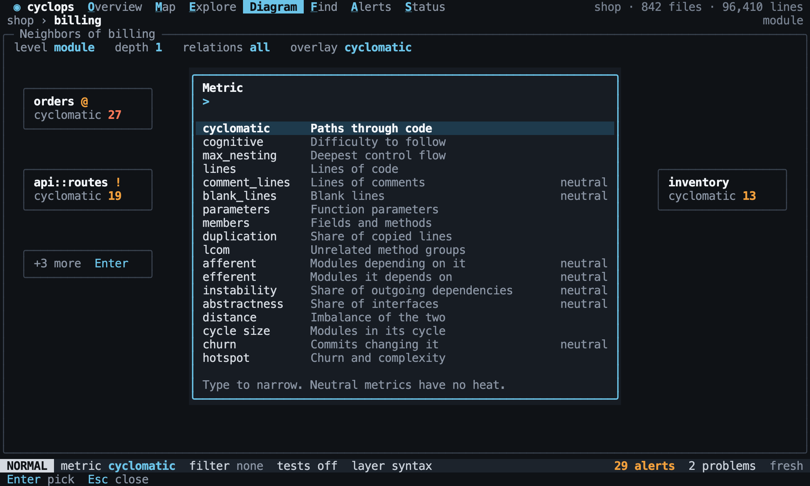

# The Lens

Back to the [terminal interface](README.md).

The lens is the focus, the metric, the filter and the test code setting. It is set
once and follows you across every view, which is what lets a list, a tree, a map and a
diagram answer the same question. [Navigation](navigation.md) covers the focus.

## The metric

`M` opens a picker of every metric in the [catalog](../metrics/catalog.md), which narrows
as you type. `]m` and `[m` step through the metrics in the order of the
[Overview](overview.md) list, and skip those that are unavailable.

[//]: # "import Spec.Fixtures"
[//]: # "decisionTable Tui -- snooze until 2099-12-31"

| # situation           | workspace | steps      | keys                | metric?      | popup?        |
| --------------------- | --------- | ---------- | ------------------- | ------------ | ------------- |
| The picker            | rust-shop |            | `M`                 | cyclomatic   | metric picker |
| Picking               | rust-shop |            | `Mcognitive<CR>`    | cognitive    | none          |
| Any metric            | rust-shop |            | `Mabstractness<CR>` | abstractness | none          |
| Narrowing             | rust-shop |            | `Minst<CR>`         | instability  | none          |
| Cancelling            | rust-shop |            | `Mcog<Esc>`         | cyclomatic   | none          |
| The next one          | rust-shop |            | `]m`                | cognitive    | none          |
| The previous one      | rust-shop |            | `]m[m`              | cyclomatic   | none          |
| Skips what is missing | rust-shop |            | `[m`                | cycle size   | none          |
| Wraps around          | rust-shop | `git init` | `]m`                | cyclomatic   | none          |

The metric stays when the view changes, and a view that cannot show it says so. A
symbol with no value shows `n/a`, and is never shown as 0.

[//]: # "decisionTable Tui -- snooze until 2099-12-31"

| # situation    | workspace | keys                     | view?   | metric?   | text              | includes? |
| -------------- | --------- | ------------------------ | ------- | --------- | ----------------- | --------- |
| Across views   | rust-shop | `Mcognitive<CR><Space>e` | Explore | cognitive | cognitive         | yes       |
| To a diagram   | rust-shop | `Mcognitive<CR><Space>d` | Diagram | cognitive | overlay cognitive | yes       |
| Does not apply | rust-shop | `Mlcom<CR><Space>e`      | Explore | lcom      | n/a               | yes       |

## The filter

`f` edits the filter, using the [filter language](../explore/filters.md). `Enter` applies
it, `Esc` leaves it as it was, and `F` clears it. A filter that cannot be understood is
refused and says why. It stays in the prompt so that it can be fixed.

[//]: # "decisionTable Tui -- snooze until 2099-12-31"

| # situation     | workspace | keys                                                  | filter?       | mode?  | text                                     | includes? |
| --------------- | --------- | ----------------------------------------------------- | ------------- | ------ | ---------------------------------------- | --------- |
| Applying        | rust-shop | `fkind = struct<CR>`                                  | kind = struct | NORMAL | kind = struct                            | yes       |
| Cancelling      | rust-shop | `fkind = struct<Esc>`                                 | none          | NORMAL | filter none                              | yes       |
| Clearing        | rust-shop | `fkind = struct<CR>F`                                 | none          | NORMAL | filter none                              | yes       |
| Editing it      | rust-shop | `fkind = struct<CR>f<BS><BS><BS><BS><BS><BS>enum<CR>` | kind = enum   | NORMAL | kind = enum                              | yes       |
| An unknown name | rust-shop | `fnonsense > 1<CR>`                                   | none          | FILTER | Unknown metric or property: nonsense     | yes       |
| Unfinished      | rust-shop | `fcyclomatic ><CR>`                                   | none          | FILTER | Invalid filter: expected a value after > | yes       |

The filter narrows every list, tree, map and diagram the same way: a symbol stays when
it [matches or when something inside it does](../explore/filters.md#in-a-hierarchy). So one
question can be followed across views, and values stay whole.

[//]: # "decisionTable Tui -- snooze until 2099-12-31"

| # situation | workspace | keys                            | view?   | rows?                                      |
| ----------- | --------- | ------------------------------- | ------- | ------------------------------------------ |
| In a list   | rust-shop | `fkind = interface<CR><Space>f` | Find    | shop::catalog::Priced                      |
| In a tree   | rust-shop | `fkind = interface<CR><Space>e` | Explore | shop, shop::catalog, shop::catalog::Priced |
| No matches  | rust-shop | `fcyclomatic > 99<CR><Space>f`  | Find    | none                                       |

[//]: # "decisionTable Tui -- snooze until 2099-12-31"

| # situation   | workspace | keys                                            | view?   | nodes?                      |
| ------------- | --------- | ----------------------------------------------- | ------- | --------------------------- |
| In a diagram  | rust-shop | `fpath ~ "src/o*"<CR><Space>d`                  | Diagram | shop::orders                |
| Inside a node | rust-shop | `fkind = method and cyclomatic > 1<CR><Space>d` | Diagram | shop::billing, shop::orders |

## Test code

`Space t` switches [test code](../analysis/test-code.md) on or off for this session, and
never changes the configuration. It never parses anything again. A focus that becomes
hidden moves to the nearest thing that is still visible.

[//]: # "decisionTable Tui -- snooze until 2099-12-31"

| # situation    | workspace | steps                    | keys                          | tests? | focus?      | text      | includes? |
| -------------- | --------- | ------------------------ | ----------------------------- | ------ | ----------- | --------- | --------- |
| On             | rust-shop |                          | `<Space>t`                    | on     | shop        | tests on  | yes       |
| Off again      | rust-shop |                          | `<Space>t<Space>t`            | off    | shop        | tests off | yes       |
| Starting on    | rust-shop | `set tests.include true` | `<Space>t`                    | off    | shop        | tests off | yes       |
| A hidden focus | rust-shop | `set tests.include true` | `<C-p>says_hello<CR><Space>t` | off    | shop::notes | tests off | yes       |

[//]: # "decisionTable Tui -- snooze until 2099-12-31"

| # situation | workspace | keys       | config text   | config includes? |
| ----------- | --------- | ---------- | ------------- | ---------------- |
| Not saved   | rust-shop | `<Space>t` | tests.include | no               |
