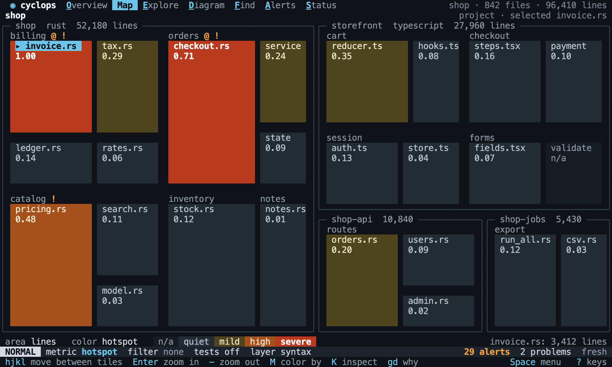

# Map

Back to the [terminal interface](README.md).

The map answers "how big is each part, and where is the risk?". It is a treemap of the
focus: each tile is a child, its area shows how many lines it has, and its color shows
the current metric. A tile prints its value, so color is never the only signal.

## Tiles

`tiles?` lists what is showing. `Enter` zooms into the selected tile and `-` zooms out.
Zooming moves the focus. `hjkl` move to the nearest tile in that direction.

[//]: # "import Spec.Fixtures"
[//]: # "decisionTable Tui"

| # situation | workspace | keys                       | focus?       | tiles?                                                  |
| ----------- | --------- | -------------------------- | ------------ | ------------------------------------------------------- |
| The project | rust-shop | `<Space>m`                 | shop         | shop::billing, shop::catalog, shop::notes, shop::orders |
| Zooming in  | rust-shop | `<Space>m/orders<CR><CR>`  | shop::orders | shop::orders::Order                                     |
| Zooming out | rust-shop | `<Space>m/orders<CR><CR>-` | shop         | shop::billing, shop::catalog, shop::notes, shop::orders |
| The top     | rust-shop | `<Space>m-`                | shop         | shop::billing, shop::catalog, shop::notes, shop::orders |

The focus decides what the map shows, so a focus deep in the tree starts deep in the map.
A focus with nothing inside it shows its parent, with its own tile selected.

[//]: # "decisionTable Tui"

| # situation    | workspace | keys                            | tiles?                                                                              |
| -------------- | --------- | ------------------------------- | ----------------------------------------------------------------------------------- |
| From a jump    | rust-shop | `<C-p>Order<CR><Space>m`        | shop::orders::Order::add, shop::orders::Order::invoices, shop::orders::Order::total |
| Nothing inside | rust-shop | `<C-p>Order::total<CR><Space>m` | shop::orders::Order::add, shop::orders::Order::invoices, shop::orders::Order::total |

Larger tiles have larger areas. `largest?` is the tile with the most lines.

[//]: # "decisionTable Tui -- snooze until 2099-12-31"

| # situation | workspace | keys       | largest?     |
| ----------- | --------- | ---------- | ------------ |
| By lines    | rust-shop | `<Space>m` | shop::orders |

## Color

`tile value?` reads the value on the `subject` tile. A tile with no value has no color
and prints `n/a`.

[//]: # "decisionTable Tui -- snooze until 2099-12-31"

| # situation    | workspace | keys                                            | subject      | tile value? |
| -------------- | --------- | ----------------------------------------------- | ------------ | ----------- |
| The metric     | rust-shop | `<Space>m`                                      | shop::orders | 3           |
| Changing it    | rust-shop | `<Space>mMinstability<CR>`                      | shop::orders | 1.00        |
| No value       | rust-shop | `<Space>mMinstability<CR>`                      | shop::notes  | n/a         |
| Does not apply | rust-shop | `<Space>mMlcom<CR>`                             | shop::orders | n/a         |
| Stays whole    | rust-shop | `<Space>mfkind = method and cyclomatic = 1<CR>` | shop::orders | 3           |

## Marks and filters

A tile or a group shows `!` when something in it has an alert, and `@` when it is in
a cycle. A filter hides tiles with [nothing that matches](../explore/filters.md#in-a-hierarchy)
inside them, and the value on a tile stays whole.

[//]: # "decisionTable Tui -- snooze until 2099-12-31"

| # situation | workspace   | steps                                       | keys       | subject      | marks? |
| ----------- | ----------- | ------------------------------------------- | ---------- | ------------ | ------ |
| An alert    | rust-shop   | `add alert cyclomatic function > 2 warning` | `<Space>m` | shop::orders | !      |
| An error    | rust-shop   | `add alert cyclomatic function > 2 error`   | `<Space>m` | shop::orders | !!     |
| A cycle     | rust-cycles |                                             | `<Space>m` | cycles::a    | @      |
| Nothing     | rust-shop   |                                             | `<Space>m` | shop::notes  | none   |

[//]: # "decisionTable Tui"

| # situation   | workspace | keys                                            | tiles?                      |
| ------------- | --------- | ----------------------------------------------- | --------------------------- |
| Filtered      | rust-shop | `fpath ~ "src/o*"<CR><Space>m`                  | shop::orders                |
| Inside a tile | rust-shop | `fkind = method and cyclomatic > 1<CR><Space>m` | shop::billing, shop::orders |

A kept tile keeps its whole value, so the legend says how much the filter left out.

[//]: # "decisionTable Tui -- snooze until 2099-12-31"

| # situation | workspace | keys                           | text         | includes? |
| ----------- | --------- | ------------------------------ | ------------ | --------- |
| Filtered    | rust-shop | `fpath ~ "src/o*"<CR><Space>m` | 1 of 4 tiles | yes       |
