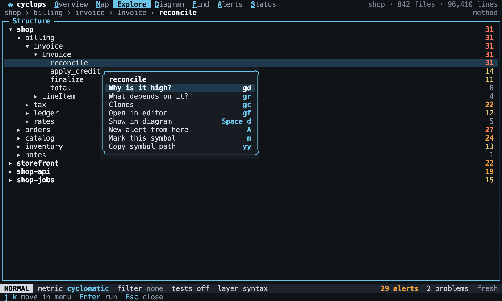

# Mouse

Back to the [terminal interface](README.md).

The mouse is a shortcut and a teacher. Each thing it does has a key, and whatever it
touches shows that key, so that using it teaches the keyboard. Nothing is mouse-only.

Capturing the mouse stops a terminal from selecting text, so `Shift` and a drag is left
to the terminal, and `yy` copies a symbol.

## Clicking

A click selects, and a double click does what `Enter` does.

[//]: # "import Spec.Fixtures"
[//]: # "decisionTable Tui"

| # situation    | workspace | keys                                         | view?   | focus?       | selected?    |
| -------------- | --------- | -------------------------------------------- | ------- | ------------ | ------------ |
| A tab          | rust-shop | `<click tab Diagram>`                        | Diagram | shop         | shop         |
| A row          | rust-shop | `<Space>e<click symbol shop::orders>`        | Explore | shop::orders | shop::orders |
| A double click | rust-shop | `<Space>e<double-click symbol shop::orders>` | Explore | shop::orders | shop::orders |
| A breadcrumb   | rust-shop | `<Space>ej<click breadcrumb shop>`           | Explore | shop         | shop         |

[//]: # "decisionTable Tui"

| # situation          | workspace | keys                                         | rows?                                                                              |
| -------------------- | --------- | -------------------------------------------- | ---------------------------------------------------------------------------------- |
| A double click opens | rust-shop | `<Space>e<double-click symbol shop::orders>` | shop, shop::orders, shop::orders::Order, shop::billing, shop::catalog, shop::notes |

## Every list and popup

Every row of every list and every entry of every popup answers the mouse. A click
selects, and a double click does what `Enter` does. In a popup, a click on an entry
chooses it, and a click outside closes the popup and does nothing else. The wheel
scrolls the list or popup under it, one row at a time, and leaves the selection where
it is.

[//]: # "decisionTable Tui"

| # situation      | workspace | steps                                       | keys                                                          | view?    | metric?     | focus?                        | section? |
| ---------------- | --------- | ------------------------------------------- | ------------------------------------------------------------- | -------- | ----------- | ----------------------------- | -------- |
| A metric         | rust-shop |                                             | `<click metric instability>`                                  | Overview | instability | shop                          | closed   |
| Opening a metric | rust-shop |                                             | `<double-click metric instability>`                           | Explore  | instability | shop::orders                  | closed   |
| The ranking      | rust-shop |                                             | `<double-click symbol shop::billing::Invoice::total>`         | Explore  | cyclomatic  | shop::billing::Invoice::total | closed   |
| A hit            | rust-shop | `add alert cyclomatic function > 1 warning` | `<Space>a<double-click symbol shop::billing::Invoice::total>` | Explore  | cyclomatic  | shop::billing::Invoice::total | closed   |
| A section        | rust-shop |                                             | `<Space>eK<click section Clones>`                             | Explore  | cyclomatic  | shop                          | Clones   |

[//]: # "decisionTable Tui"

| # situation | workspace | steps                                                                                              | keys                           | rules?                           | rows?                                                     |
| ----------- | --------- | -------------------------------------------------------------------------------------------------- | ------------------------------ | -------------------------------- | --------------------------------------------------------- |
| A rule      | rust-shop | `add alert cyclomatic function > 1 warning named Complex; add alert instability module >= 1 error` | `<Space>a<click rule Complex>` | instability module >= 1, Complex | shop::orders::Order::total, shop::billing::Invoice::total |

[//]: # "decisionTable Tui"

| # situation | workspace | steps             | keys                                        | view?  | opened?      |
| ----------- | --------- | ----------------- | ------------------------------------------- | ------ | ------------ |
| A problem   | broken    | `env EDITOR fake` | `<Space>s<double-click problem web/bad.ts>` | Status | web/bad.ts:1 |

[//]: # "decisionTable Tui"

| # situation   | workspace | keys                                     | section? | line? |
| ------------- | --------- | ---------------------------------------- | -------- | ----- |
| A line of Why | rust-shop | `<C-p>Order::total<CR>gd<click line 16>` | Why      | 16    |

[//]: # "decisionTable Tui"

| # situation         | workspace | keys                                                       | view?    | popup? | mode?  | metric?     | relations? | filter?       |
| ------------------- | --------- | ---------------------------------------------------------- | -------- | ------ | ------ | ----------- | ---------- | ------------- |
| The metric picker   | rust-shop | `M<click menu instability>`                                | Overview | none   | NORMAL | instability | all        | none          |
| The relation picker | rust-shop | `<Space>dr<click menu imports>`                            | Diagram  | none   | NORMAL | cyclomatic  | imports    | none          |
| A completion        | rust-shop | `<Space>ffcog<click menu cognitive> > 1<CR>`               | Find     | none   | NORMAL | cyclomatic  | all        | cognitive > 1 |
| Not now             | rust-shop | `<Space>p<click menu not now>`                             | Overview | none   | NORMAL | cyclomatic  | all        | none          |
| Outside a picker    | rust-shop | `M<click outside>`                                         | Overview | none   | NORMAL | cyclomatic  | all        | none          |
| Outside, on a tab   | rust-shop | `M<click tab Diagram>`                                     | Overview | none   | NORMAL | cyclomatic  | all        | none          |
| Outside the menu    | rust-shop | `<Space>e<right-click symbol shop::orders><click outside>` | Explore  | none   | NORMAL | cyclomatic  | all        | none          |
| Outside help        | rust-shop | `?<click outside>`                                         | Overview | none   | NORMAL | cyclomatic  | all        | none          |

[//]: # "decisionTable Tui"

| # situation    | workspace | keys                                 | popup? | text        | includes? |
| -------------- | --------- | ------------------------------------ | ------ | ----------- | --------- |
| Help           | rust-shop | `<Space>e<Space>?`                   | help   | pick metric | yes       |
| Scrolling help | rust-shop | `<Space>e<Space>?<wheel down popup>` | help   | pick metric | no        |

## The status line

Each part of the status line can be clicked.

[//]: # "decisionTable Tui"

| # situation | workspace | keys                  | popup?        | mode?  | tests? |
| ----------- | --------- | --------------------- | ------------- | ------ | ------ |
| The metric  | rust-shop | `<click chip metric>` | metric picker | NORMAL | off    |
| The filter  | rust-shop | `<click chip filter>` | none          | FILTER | off    |
| Test code   | rust-shop | `<click chip tests>`  | none          | NORMAL | on     |

[//]: # "decisionTable Tui"

| # situation  | workspace | keys                    | view?  |
| ------------ | --------- | ----------------------- | ------ |
| The problems | broken    | `<click chip problems>` | Status |
| The alerts   | rust-shop | `<click chip alerts>`   | Alerts |

## The right-click menu

A right click selects what is under it and opens its actions. Each one shows its key.

[//]: # "decisionTable Tui"

| # situation | workspace | keys                                                           | popup?           | popup keys?                       | view?   | section? |
| ----------- | --------- | -------------------------------------------------------------- | ---------------- | --------------------------------- | ------- | -------- |
| Opens       | rust-shop | `<Space>e<right-click symbol shop::orders>`                    | right-click menu | A, Space d, gc, gd, gf, gr, m, yy | Explore | closed   |
| An action   | rust-shop | `<Space>e<right-click symbol shop::orders><click menu Clones>` | none             | none                              | Explore | Clones   |
| With keys   | rust-shop | `<Space>e<right-click symbol shop::orders>j<CR>`               | none             | none                              | Diagram | Impact   |
| Closing     | rust-shop | `<Space>e<right-click symbol shop::orders><Esc>`               | none             | none                              | Explore | closed   |

## Scrolling, dragging and hovering

The wheel scrolls what is under it, and pans a diagram. `Ctrl` and the wheel changes
the diagram's depth. Dragging a divider resizes panes, and dragging a diagram pans it.
Hovering shows what a click would do in the hint line, and changes nothing.

[//]: # "decisionTable Tui"

| # situation | workspace | keys                                  | depth? | selected? | inspector width? | text         | includes? |
| ----------- | --------- | ------------------------------------- | ------ | --------- | ---------------- | ------------ | --------- |
| Depth up    | rust-shop | `<Space>d<ctrl-wheel up>`             | 2      | shop      | closed           | depth 2      | yes       |
| Depth down  | rust-shop | `<Space>d><ctrl-wheel down>`          | 1      | shop      | closed           | depth 1      | yes       |
| A divider   | rust-shop | `<Space>eK<drag divider -5>`          | none   | shop      | 63               | Inspector    | yes       |
| Hovering    | rust-shop | `<Space>e<hover symbol shop::orders>` | none   | shop      | closed           | shop::orders | yes       |
| The wheel   | rust-shop | `<Space>e<wheel down>`                | none   | shop      | closed           | shop         | yes       |
