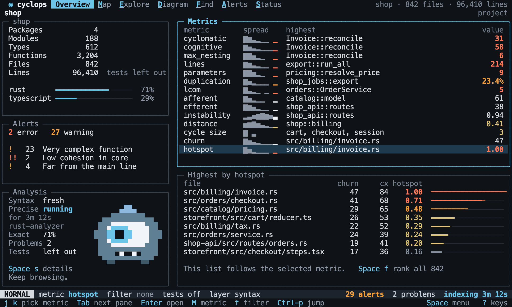
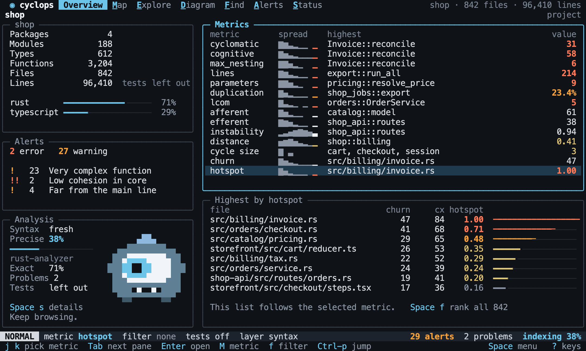
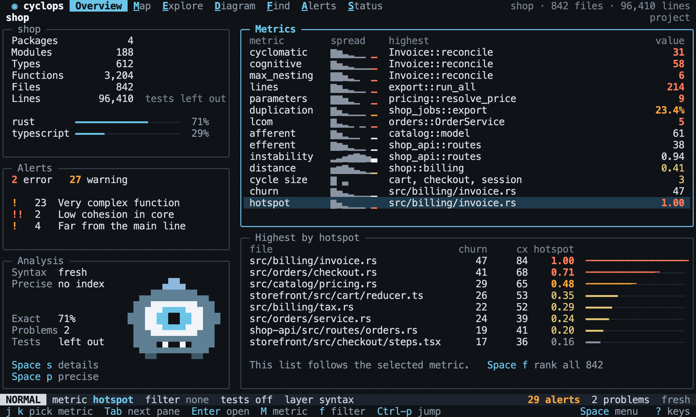

# Overview

Back to the [terminal interface](README.md).

Overview answers "where should I look first?". It treats every metric equally: there
is one list of them, with no metric given its own panel and no combined score.

When the indexer reports a percentage, it shows that as well:

The same view when nothing is running:

## Metrics

The metrics list has one row for each main metric, in this order: `cyclomatic`, `cognitive`,
`max_nesting`, `lines`, `parameters`, `duplication`, `lcom`, `afferent`, `efferent`,
`instability`, `distance`, `cycle size`, `churn`, `hotspot`. Each row shows the
[spread](../explore/ranking.md#spread) and the [worst symbol](../explore/ranking.md#worst-per-metric).
Moving through the list changes the metric of the lens. The rest of the
[catalog](../metrics/catalog.md) is in the metric picker.

`worst?` and `value?` read the row of the current metric.

[//]: # "import Spec.Fixtures"
[//]: # "decisionTable Tui -- snooze until 2099-12-31"

| # situation   | workspace   | keys               | metric?     | worst?                          | value? |
| ------------- | ----------- | ------------------ | ----------- | ------------------------------- | ------ |
| The first     | rust-shop   |                    | cyclomatic  | shop::orders::Order::total      | 3      |
| Moving down   | rust-shop   | `j`                | cognitive   | shop::orders::Order::total      | 3      |
| By the picker | rust-shop   | `Minstability<CR>` | instability | shop::orders                    | 1.00   |
| A cycle       | rust-cycles | `Mcycle<CR>`       | cycle size  | cycles::c, cycles::d, cycles::e | 3      |
| No cycles     | rust-shop   | `Mcycle<CR>`       | cycle size  | none                            | n/a    |

A metric that cannot be worked out stays in the list and says why.

[//]: # "decisionTable Tui"

| # situation | workspace | steps | text           | includes? |
| ----------- | --------- | ----- | -------------- | --------- |
| Without git | rust-shop |       | no git history | yes       |

## The ranking

Under the list, the worst symbols by the current metric. It shows up to eight, follows
the lens, and respects the filter. `Tab` moves into it, and `Enter` opens a symbol in
Explore. `ranking?` lists it in order.

[//]: # "decisionTable Tui -- snooze until 2099-12-31"

| # situation | workspace | keys                   | ranking?                                                                                                                                                                |
| ----------- | --------- | ---------------------- | ----------------------------------------------------------------------------------------------------------------------------------------------------------------------- |
| Functions   | rust-shop |                        | shop::orders::Order::total, shop::billing::Invoice::total, shop::billing::Invoice::is_free, shop::catalog::Item::price, shop::notes::greeting, shop::orders::Order::add |
| Modules     | rust-shop | `Minstability<CR>`     | shop::orders, shop::billing, shop::catalog                                                                                                                              |
| Filtered    | rust-shop | `fpath ~ "src/o*"<CR>` | shop::orders::Order::total, shop::orders::Order::add                                                                                                                    |

[//]: # "decisionTable Tui"

| # situation | workspace | keys         | view?   | focus?                        |
| ----------- | --------- | ------------ | ------- | ----------------------------- |
| Opening     | rust-shop | `<Tab><CR>`  | Explore | shop::orders::Order::total    |
| The second  | rust-shop | `<Tab>j<CR>` | Explore | shop::billing::Invoice::total |

## The project

The summary counts what is measured, so it changes with test code.

[//]: # "decisionTable Tui -- snooze until 2099-12-31"

| # situation | workspace | keys       | text       | includes? |
| ----------- | --------- | ---------- | ---------- | --------- |
| Modules     | rust-shop |            | Modules    | yes       |
| Lines       | rust-shop |            | 55         | yes       |
| With tests  | rust-shop | `<Space>t` | 69         | yes       |
| A language  | rust-shop |            | rust       | yes       |
| Another     | ts-shop   |            | typescript | yes       |

## Alerts

The alert panel shows the count at each severity, and the hits of each rule.

[//]: # "decisionTable Tui -- snooze until 2099-12-31"

| # situation     | workspace | steps                                                     | text                    | includes? |
| --------------- | --------- | --------------------------------------------------------- | ----------------------- | --------- |
| No rules        | rust-shop |                                                           | No alert rules          | yes       |
| Quiet           | rust-shop | `add alert cyclomatic function > 99 warning`              | 0 warning               | yes       |
| A warning       | rust-shop | `add alert cyclomatic function > 2 warning`               | 1 warning               | yes       |
| An error        | rust-shop | `add alert instability module >= 1 error`                 | 1 error                 | yes       |
| A named rule    | rust-shop | `add alert cyclomatic function > 2 warning named Complex` | Complex                 | yes       |
| An unnamed rule | rust-shop | `add alert cyclomatic function > 2 warning`               | cyclomatic function > 2 | yes       |

## Analysis

The analysis panel says what the analysis is doing and how far to trust it: whether
the syntax layer is fresh, how far precise analysis has got, the share of relations
that are exact, the problem count, and the test code setting. It takes you to
[Status](status.md) for the details. `pause before indexing` holds a precise analysis.

The [mascot](design/README.md#the-mascot) lives here, and shows the same state.

[//]: # "decisionTable Tui -- snooze until 2099-12-31"

| # situation     | workspace | steps                   | keys                                                       | mascot?      | text                   | includes? |
| --------------- | --------- | ----------------------- | ---------------------------------------------------------- | ------------ | ---------------------- | --------- |
| Idle            | rust-shop |                         |                                                            | watching     | no index               | yes       |
| Analyzing       | rust-shop | `pause before link`     |                                                            | scanning     | Extract                | yes       |
| Indexing        | rust-shop | `pause before indexing` | `<Space>py`                                                | scanning     | rust-analyzer          | yes       |
| Indexed         | rust-shop | `precise analysis`      |                                                            | watching     | Precise                | yes       |
| New alerts      | rust-shop |                         | `<step add alert cyclomatic function > 1 warning><Space>r` | found        | 2 warning              | yes       |
| Nothing to read | docs-only |                         |                                                            | nothing here | No source files found. | yes       |
