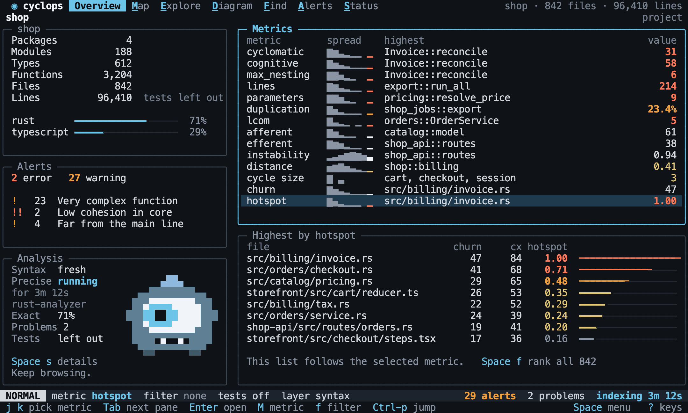
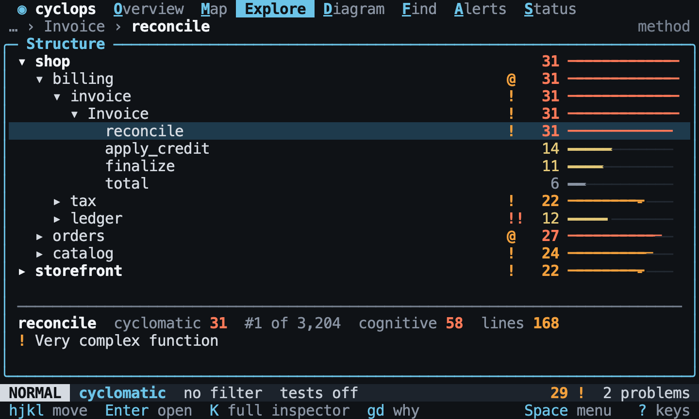

# The Shell

Back to the [terminal interface](README.md).

The shell is what stays on screen in every view: the tab bar, the breadcrumb, the
status line and the hint line. See the [design](design/README.md#the-shell) for where
each one goes.

## Starting

The interface opens on Overview, with the focus on the project. The metric starts on
`hotspot` when the project has git history, and on `cyclomatic` when it does not.

[//]: # "import Spec.Fixtures"
[//]: # "decisionTable Tui -- snooze until 2099-12-31"

| # situation        | workspace | steps                    | view?    | mode?  | focus? | metric?    | filter? | tests? | text                                    | includes? |
| ------------------ | --------- | ------------------------ | -------- | ------ | ------ | ---------- | ------- | ------ | --------------------------------------- | --------- |
| No history         | rust-shop |                          | Overview | NORMAL | shop   | cyclomatic | none    | off    | shop                                    | yes       |
| With history       | rust-shop | `git init`               | Overview | NORMAL | shop   | hotspot    | none    | off    | shop                                    | yes       |
| Test code on       | rust-shop | `set tests.include true` | Overview | NORMAL | shop   | cyclomatic | none    | on     | shop                                    | yes       |
| Nothing to analyze | docs-only |                          | Overview | NORMAL | none   | cyclomatic | none    | off    | No source files found.                  | yes       |
| Bad settings       | rust-shop | `break config`           | Overview | NORMAL | none   | cyclomatic | none    | off    | .cyclops/config.toml is not valid TOML. | yes       |

## Views

`Space` and a letter goes to a view. `gt` and `gT` go to the next and the previous one,
and wrap around. A count goes to that view by its place, as in Vim.

[//]: # "decisionTable Tui -- snooze until 2099-12-31"

| # situation    | workspace | keys               | view?    |
| -------------- | --------- | ------------------ | -------- |
| Overview       | rust-shop | `<Space>e<Space>o` | Overview |
| Map            | rust-shop | `<Space>m`         | Map      |
| Explore        | rust-shop | `<Space>e`         | Explore  |
| Diagram        | rust-shop | `<Space>d`         | Diagram  |
| Find           | rust-shop | `<Space>f`         | Find     |
| Alerts         | rust-shop | `<Space>a`         | Alerts   |
| Status         | rust-shop | `<Space>s`         | Status   |
| Next           | rust-shop | `gt`               | Map      |
| Wraps forward  | rust-shop | `<Space>sgt`       | Overview |
| Previous       | rust-shop | `<Space>mgT`       | Overview |
| Wraps backward | rust-shop | `gT`               | Status   |
| By its place   | rust-shop | `3gt`              | Explore  |

## Modes

The status line always shows the mode. `Esc` returns to NORMAL from any other mode and
loses what was being typed. In a [rule being edited](alerts.md#a-new-rule), it leaves the
field, and `:q` leaves the rule.

[//]: # "decisionTable Tui -- snooze until 2099-12-31"

| # situation    | workspace | keys        | mode?   |
| -------------- | --------- | ----------- | ------- |
| Command line   | rust-shop | `:`         | COMMAND |
| Filter         | rust-shop | `f`         | FILTER  |
| Search         | rust-shop | `/`         | SEARCH  |
| Back to normal | rust-shop | `:abc<Esc>` | NORMAL  |

## The status line

The status line shows the mode, the lens, the layer, the alert count, the problem
count and whether the results are fresh. `layer` is `syntax` until a precise analysis
has finished, and `precise` after it.

[//]: # "decisionTable Tui -- snooze until 2099-12-31"

| # situation   | workspace | steps                                       | keys                                  | text             | includes? |
| ------------- | --------- | ------------------------------------------- | ------------------------------------- | ---------------- | --------- |
| The metric    | rust-shop |                                             | `Mcognitive<CR>`                      | metric cognitive | yes       |
| The filter    | rust-shop |                                             | `fkind = struct<CR>`                  | kind = struct    | yes       |
| Test code     | rust-shop |                                             | `<Space>t`                            | tests on         | yes       |
| Syntax layer  | rust-shop |                                             |                                       | layer syntax     | yes       |
| Precise layer | rust-shop | `precise analysis`                          |                                       | layer precise    | yes       |
| Alert count   | rust-shop | `add alert cyclomatic function > 1 warning` |                                       | 2 alerts         | yes       |
| Problem count | broken    |                                             |                                       | 2 problems       | yes       |
| Fresh         | rust-shop |                                             |                                       | fresh            | yes       |
| Changed files | rust-shop |                                             | `<step edit src/orders.rs><wait 500>` | stale            | yes       |

## The hint line

The last line lists the most useful keys for the view, and always ends with the keys
for the Space menu and for help. While a prompt is open, Space types a space, so the
hint line drops the menu.

[//]: # "decisionTable Tui -- snooze until 2099-12-31"

| # situation | workspace | keys       | text       | includes? | other text | other includes? |
| ----------- | --------- | ---------- | ---------- | --------- | ---------- | --------------- |
| Always      | rust-shop |            | Space menu | yes       | none       | no              |
| In a view   | rust-shop | `<Space>d` | depth      | yes       | none       | no              |
| In a prompt | rust-shop | `f`        | apply      | yes       | Space menu | no              |

## Sizes

The layout adapts to the terminal. Below 100 columns, the inspector opens over the
other pane instead of beside it. `panes?` lists what is showing. Below 80 columns or
24 rows, the interface says so and waits for a bigger terminal.

[//]: # "decisionTable Tui -- snooze until 2099-12-31"

| # situation  | workspace | size   | keys              | panes?               | text                                              | includes? | running? |
| ------------ | --------- | ------ | ----------------- | -------------------- | ------------------------------------------------- | --------- | -------- |
| Side by side | rust-shop |        | `<Space>eK`       | structure, inspector | Inspector                                         | yes       | yes      |
| At the limit | rust-shop | 100x30 | `<Space>eK`       | structure, inspector | Inspector                                         | yes       | yes      |
| Over it      | rust-shop | 99x30  | `<Space>eK`       | inspector            | Inspector                                         | yes       | yes      |
| Smallest     | rust-shop | 80x24  | `<Space>e`        | structure            | Structure                                         | yes       | yes      |
| Too small    | rust-shop | 79x24  |                   | none                 | The terminal is too small. Cyclops needs 80 x 24. | yes       | yes      |
| Grows again  | rust-shop | 79x24  | `<resize 120x36>` | metrics, ranking     | Overview                                          | yes       | yes      |

Resizing keeps the view, the lens and the selection.

[//]: # "decisionTable Tui -- snooze until 2099-12-31"

| # situation  | workspace | keys                      | view?   | focus?       |
| ------------ | --------- | ------------------------- | ------- | ------------ |
| After resize | rust-shop | `<Space>ej<resize 80x24>` | Explore | shop::orders |

## Quitting

`Space q` and `:q` quit. `q` closes a pane or a popup, and does nothing when there is
nothing to close, so that it cannot quit by accident.

[//]: # "decisionTable Tui -- snooze until 2099-12-31"

| # situation      | workspace | keys         | running? | section? |
| ---------------- | --------- | ------------ | -------- | -------- |
| From the menu    | rust-shop | `<Space>q`   | no       | closed   |
| From the command | rust-shop | `:q<CR>`     | no       | closed   |
| Nothing to close | rust-shop | `q`          | yes      | closed   |
| Closes a pane    | rust-shop | `<Space>eKq` | yes      | closed   |
