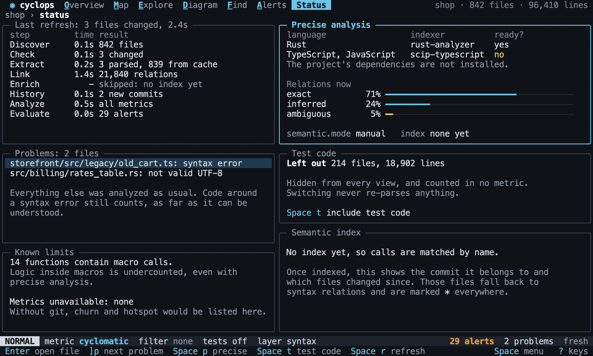
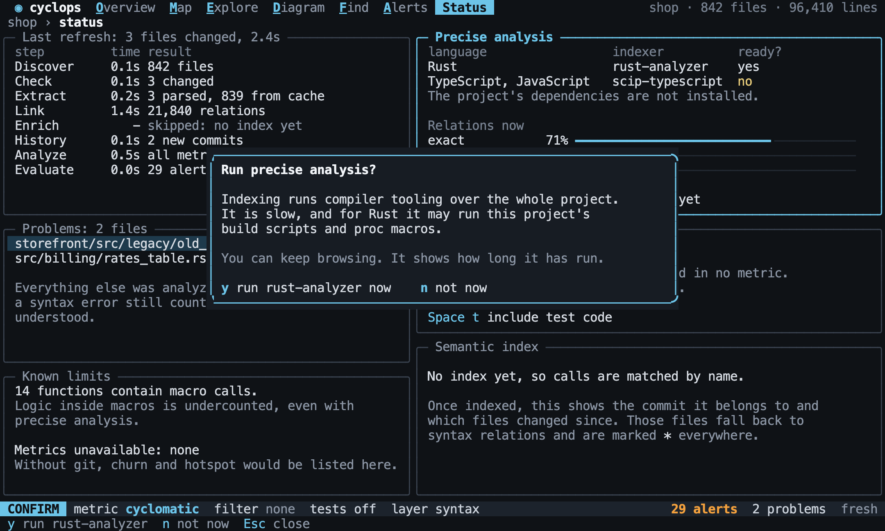
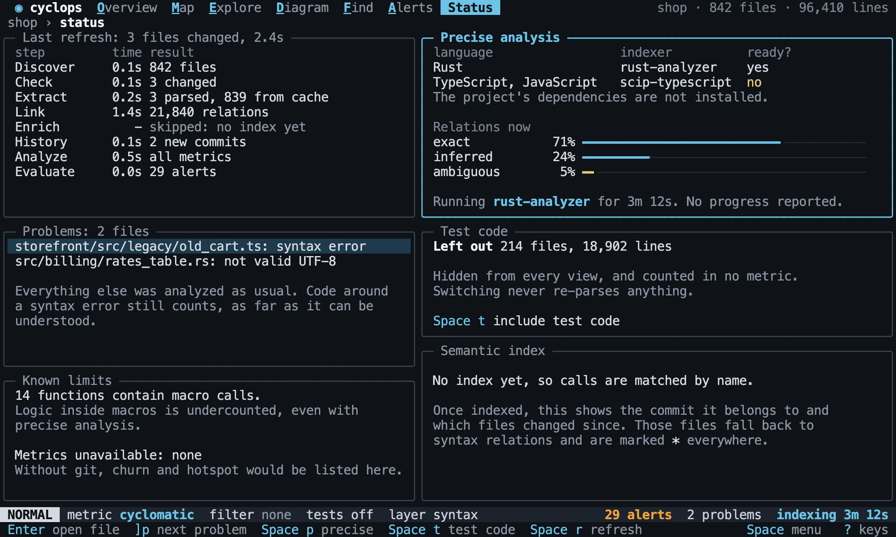

# Status

Back to the [terminal interface](README.md).

Status answers "how far can I trust what I am seeing?". It shows what the last analysis
did, how much of it is proven, and everything that was left out or could not be worked
out.

## The pipeline

Status lists each step of the last analysis with what it did. The steps are `discover`,
`check`, `extract`, `link`, `enrich`, `history`, `analyze` and `evaluate`.

[//]: # "import Spec.Fixtures"
[//]: # "decisionTable Tui -- snooze until 2099-12-31"

| # situation | workspace | steps     | keys                                        | text                  | includes? |
| ----------- | --------- | --------- | ------------------------------------------- | --------------------- | --------- |
| Found       | rust-shop |           | `<Space>s`                                  | Discover              | yes       |
| Cached      | rust-shop | `analyze` | `<Space>s`                                  | from cache            | yes       |
| One changed | rust-shop | `analyze` | `<step edit src/orders.rs><Space>r<Space>s` | 1 changed             | yes       |
| No index    | rust-shop |           | `<Space>s`                                  | skipped: no index yet | yes       |

## Precise analysis

Status shows which [indexers](../analysis/precise-analysis.md) are ready. For one that is
not, it says exactly what is missing. `ready?` reads the row of the `language`.

[//]: # "decisionTable Tui -- snooze until 2099-12-31"

| # situation | workspace | steps                       | keys       | language   | ready? |
| ----------- | --------- | --------------------------- | ---------- | ---------- | ------ |
| Ready       | rust-shop |                             | `<Space>s` | rust       | yes    |
| Missing     | rust-shop | `remove tool rust-analyzer` | `<Space>s` | rust       | no     |
| TypeScript  | ts-shop   | `remove tool node`          | `<Space>s` | typescript | no     |

`Space p` asks before it runs anything, because indexing is slow and may run the
project's build scripts. It never starts from a single key press.

[//]: # "decisionTable Tui"

| # situation   | workspace | steps                       | keys            | mode?   | popup?          | indexers run? | text                                             | includes? |
| ------------- | --------- | --------------------------- | --------------- | ------- | --------------- | ------------- | ------------------------------------------------ | --------- |
| It asks       | rust-shop |                             | `<Space>p`      | CONFIRM | confirm precise | no            | build scripts                                    | yes       |
| Yes           | rust-shop |                             | `<Space>py`     | NORMAL  | none            | yes           | layer precise                                    | yes       |
| No            | rust-shop |                             | `<Space>pn`     | NORMAL  | none            | no            | layer syntax                                     | yes       |
| Cancelled     | rust-shop |                             | `<Space>p<Esc>` | NORMAL  | none            | no            | layer syntax                                     | yes       |
| Turned off    | rust-shop | `set semantic.mode off`     | `<Space>p`      | NORMAL  | none            | no            | Precise analysis is turned off for this project. | yes       |
| Nothing ready | rust-shop | `remove tool rust-analyzer` | `<Space>p`      | NORMAL  | none            | no            | rust-analyzer is not installed.                  | yes       |

Indexing runs in the background, so you can keep browsing. The status line shows that
it is running and for how long, with a percentage only if the indexer reports one.
Results replace guesses when it finishes.

`indexer reports PERCENT` makes the indexer report its progress.

[//]: # "decisionTable Tui -- snooze until 2099-12-31"

| # situation   | workspace | steps                                        | keys        | text            | includes? | other text      | other includes? |
| ------------- | --------- | -------------------------------------------- | ----------- | --------------- | --------- | --------------- | --------------- |
| No percentage | rust-shop | `pause before indexing`                      | `<Space>py` | Precise running | yes       | Precise 38%     | no              |
| A percentage  | rust-shop | `pause before indexing; indexer reports 38%` | `<Space>py` | Precise 38%     | yes       | Precise running | no              |

[//]: # "decisionTable Tui -- snooze until 2099-12-31"

| # situation | workspace | steps                   | keys                | view?    | text          | includes? |
| ----------- | --------- | ----------------------- | ------------------- | -------- | ------------- | --------- |
| Browsing    | rust-shop | `pause before indexing` | `<Space>py<Space>e` | Explore  | indexing      | yes       |
| Finished    | rust-shop | `pause before indexing` | `<Space>py<resume>` | Overview | layer precise | yes       |

Status shows the commit an index belongs to. [Files changed since](../analysis/precise-analysis.md#results-that-are-out-of-date)
go back to syntax relations, and are marked `*` wherever they appear.

[//]: # "decisionTable Tui -- snooze until 2099-12-31"

| # situation | workspace | steps                        | keys                                        | text            | includes? |
| ----------- | --------- | ---------------------------- | ------------------------------------------- | --------------- | --------- |
| No index    | rust-shop |                              | `<Space>s`                                  | none yet        | yes       |
| Current     | rust-shop | `git init; precise analysis` | `<Space>s`                                  | 0 files changed | yes       |
| Stale       | rust-shop | `git init; precise analysis` | `<step edit src/orders.rs><Space>r<Space>s` | 1 file changed  | yes       |

## Problems

Problems lists the [files that could not be fully read](../analysis/parse-failures.md).
`]p` and `[p` step through them from any view, and `Enter` opens one in the editor.

[//]: # "decisionTable Tui -- snooze until 2099-12-31"

| # situation | workspace | steps             | keys       | view?  | rows?                                              | opened?      |
| ----------- | --------- | ----------------- | ---------- | ------ | -------------------------------------------------- | ------------ |
| None        | rust-shop |                   | `<Space>s` | Status | none                                               | none         |
| Listed      | broken    |                   | `<Space>s` | Status | src/bad.rs: syntax error, web/bad.ts: syntax error | none         |
| Stepping    | broken    |                   | `]p`       | Status | src/bad.rs: syntax error, web/bad.ts: syntax error | none         |
| Opening     | broken    | `env EDITOR fake` | `]p<CR>`   | Status | src/bad.rs: syntax error, web/bad.ts: syntax error | src/bad.rs:1 |

## What is left out

Status says what was not measured and why: test code, and any metric that is
[unavailable](../metrics/hotspots.md#without-git).

[//]: # "decisionTable Tui -- snooze until 2099-12-31"

| # situation   | workspace | steps                    | keys       | text                           | includes? |
| ------------- | --------- | ------------------------ | ---------- | ------------------------------ | --------- |
| Test code     | rust-shop |                          | `<Space>s` | Left out                       | yes       |
| Included      | rust-shop | `set tests.include true` | `<Space>s` | Included                       | yes       |
| No git        | rust-shop |                          | `<Space>s` | churn, hotspot: no git history | yes       |
| All available | rust-shop | `git init`               | `<Space>s` | Metrics unavailable: none      | yes       |
