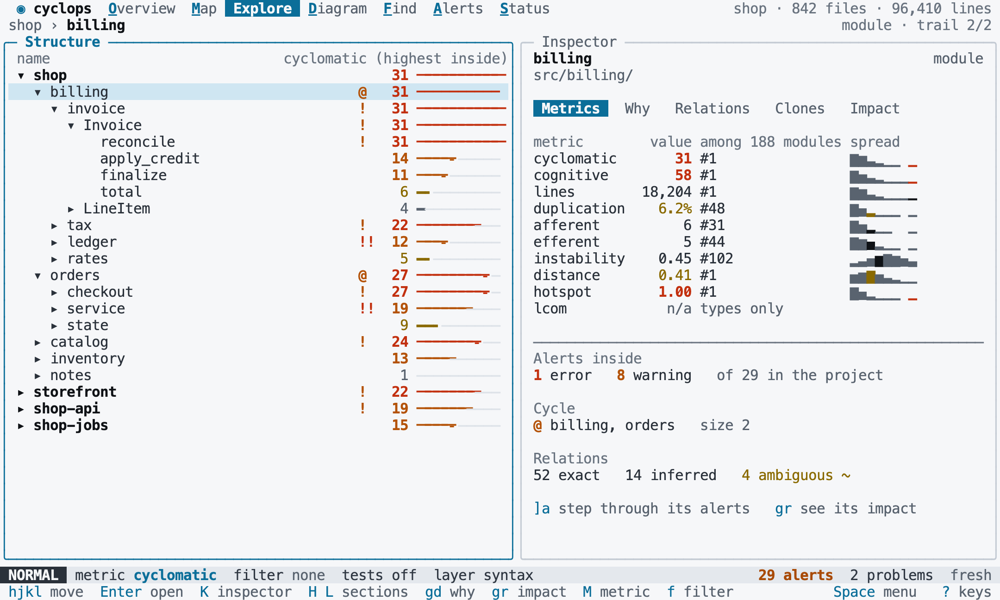

# Themes

Back to the [terminal interface](README.md).

The interface has a dark and a light theme, with the same meaning in both: warm colors
only ever mean risk, and cool colors are the interface. The colors themselves are in
the [design](design/README.md#tokens).

## Choosing a theme

`ui.theme` is `auto`, `dark` or `light`, and `auto` is the default. A theme is a personal
choice, so it can only be set in [your own file](../project/configuration.md#your-own-settings).
`auto` asks the terminal for its background color, and uses `dark` if it does not answer.

`terminal background VALUE` makes the terminal report that background.

[//]: # "import Spec.Fixtures"
[//]: # "decisionTable Tui"

| # situation       | workspace | steps                                               | theme? |
| ----------------- | --------- | --------------------------------------------------- | ------ |
| No answer         | rust-shop |                                                     | dark   |
| A dark terminal   | rust-shop | `terminal background dark`                          | dark   |
| A light terminal  | rust-shop | `terminal background light`                         | light  |
| Your choice       | rust-shop | `set user ui.theme light`                           | light  |
| Over the terminal | rust-shop | `set user ui.theme dark; terminal background light` | dark   |

`:set bg=VALUE` changes the theme for this session, and saves nothing.

[//]: # "decisionTable Tui"

| # situation | workspace | steps                                               | keys                | theme? | config text | config includes? |
| ----------- | --------- | --------------------------------------------------- | ------------------- | ------ | ----------- | ---------------- |
| Light       | rust-shop |                                                     | `:set bg=light<CR>` | light  | ui.theme    | no               |
| Dark        | rust-shop | `set user ui.theme light`                           | `:set bg=dark<CR>`  | dark   | ui.theme    | no               |
| Automatic   | rust-shop | `terminal background light; set user ui.theme dark` | `:set bg=auto<CR>`  | light  | ui.theme    | no               |

[//]: # "decisionTable Tui"

| # situation | workspace | keys               | theme? | text                | includes? |
| ----------- | --------- | ------------------ | ------ | ------------------- | --------- |
| Unknown     | rust-shop | `:set bg=pink<CR>` | dark   | Unknown theme: pink | yes       |

## Without color

When `NO_COLOR` is set, the interface uses no color at all, and `ui.theme` is ignored.
Nothing depends on color alone: alerts, cycles, confidence and selection all stay
visible, through marks, line styles, bold and reverse video.

[//]: # "decisionTable Tui"

| # situation   | workspace | steps                                                       | keys       | theme?   | text | includes? |
| ------------- | --------- | ----------------------------------------------------------- | ---------- | -------- | ---- | --------- |
| No color      | rust-shop | `env NO_COLOR 1`                                            |            | no color | shop | yes       |
| Over the file | rust-shop | `env NO_COLOR 1; set user ui.theme light`                   |            | no color | shop | yes       |
| Marks stay    | rust-shop | `env NO_COLOR 1; add alert cyclomatic function > 2 warning` | `<Space>e` | no color | !    | yes       |
