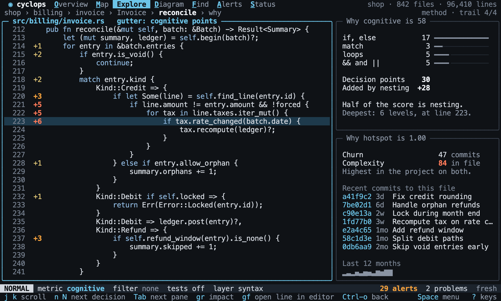
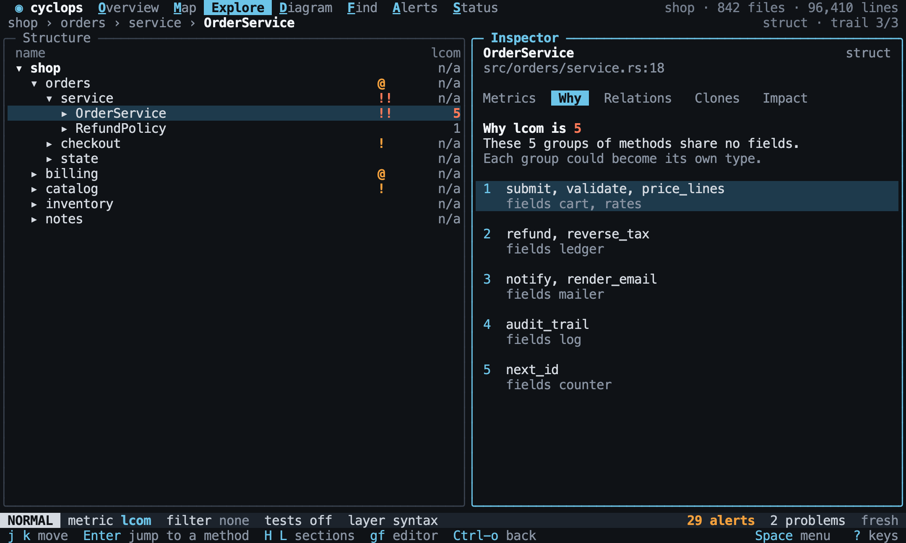
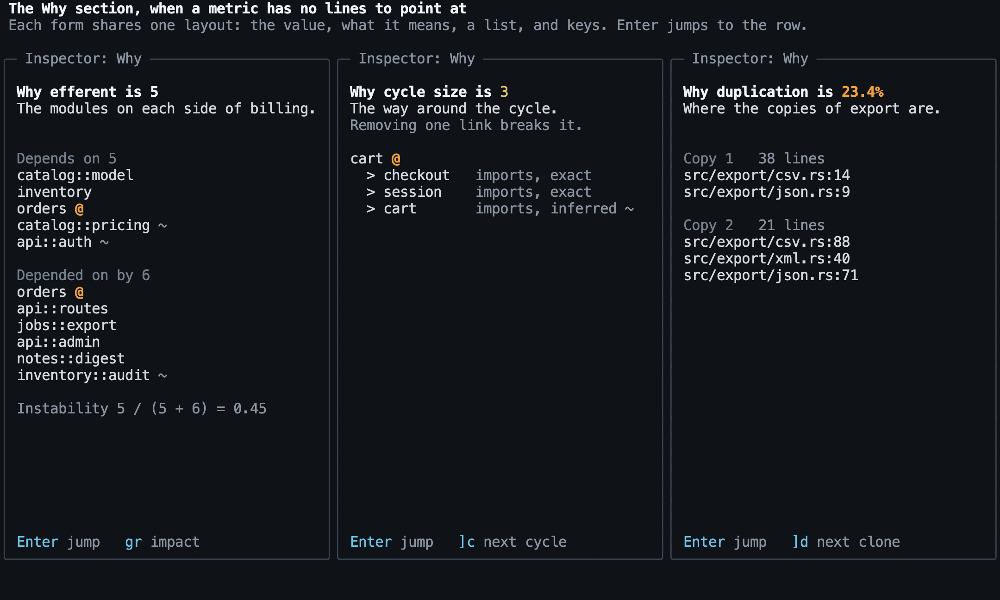

# Why

Back to the [terminal interface](README.md).

Why answers "why is this number high?". `gd` opens the source of the selection with the
reasons next to it. It is the full screen form of the inspector's Why section, and it
shows [explanations](../explore/explanations.md) from the core.

## The source

The gutter shows the cognitive points each line added. `n` and `N` step through the
lines that have points, and `line?` is the current line.

[//]: # "import Spec.Fixtures"
[//]: # "decisionTable Tui"

| # situation   | workspace | keys                         | view?   | section? | gutter?      | line? |
| ------------- | --------- | ---------------------------- | ------- | -------- | ------------ | ----- |
| Opening       | rust-shop | `<C-p>Order::total<CR>gd`    | Explore | Why      | 15 +1, 16 +2 | 13    |
| The first     | rust-shop | `<C-p>Order::total<CR>gdn`   | Explore | Why      | 15 +1, 16 +2 | 15    |
| The next      | rust-shop | `<C-p>Order::total<CR>gdnn`  | Explore | Why      | 15 +1, 16 +2 | 16    |
| Wraps around  | rust-shop | `<C-p>Order::total<CR>gdnnn` | Explore | Why      | 15 +1, 16 +2 | 15    |
| Back          | rust-shop | `<C-p>Order::total<CR>gdnnN` | Explore | Why      | 15 +1, 16 +2 | 15    |
| Straight code | rust-shop | `<C-p>greeting<CR>gd`        | Explore | Why      | none         | 1     |

`gd` on something larger than a function opens its worst function, by the current
metric, and says which one. With `hotspot` or `churn`, that is the worst function of its
worst file.

[//]: # "decisionTable Tui"

| # situation | workspace | keys          | focus?                     | text            | includes? |
| ----------- | --------- | ------------- | -------------------------- | --------------- | --------- |
| A module    | rust-shop | `<Space>ejgd` | shop::orders::Order::total | worst in orders | yes       |
| The project | rust-shop | `gd`          | shop::orders::Order::total | worst in shop   | yes       |

[//]: # "decisionTable Tui"

| # situation | workspace | steps                                    | keys | focus?                     | text          | includes? |
| ----------- | --------- | ---------------------------------------- | ---- | -------------------------- | ------------- | --------- |
| A hotspot   | rust-shop | `git init; commit src/orders.rs 2 times` | `gd` | shop::orders::Order::total | worst in shop | yes       |

## The reasons

Beside the source, Why splits the score into its decision points and what nesting
added, then shows the history behind a hotspot. Without git it says so, and the rest
still works.

[//]: # "decisionTable Tui"

| # situation | workspace | steps                                    | keys                                    | text                 | includes? |
| ----------- | --------- | ---------------------------------------- | --------------------------------------- | -------------------- | --------- |
| The score   | rust-shop |                                          | `<C-p>Order::total<CR>Mcognitive<CR>gd` | Why cognitive is 3   | yes       |
| Its parts   | rust-shop |                                          | `<C-p>Order::total<CR>Mcognitive<CR>gd` | Decision points      | yes       |
| Nesting     | rust-shop |                                          | `<C-p>Order::total<CR>Mcognitive<CR>gd` | Added by nesting     | yes       |
| The lens    | rust-shop |                                          | `<C-p>Order::total<CR>gd`               | Why cyclomatic is 3  | yes       |
| The history | rust-shop | `git init; commit src/orders.rs 2 times` | `<C-p>Order::total<CR>gd`               | Change src/orders.rs | yes       |
| Without git | rust-shop |                                          | `<C-p>Order::total<CR>gd`               | no git history       | yes       |

## What it explains

Why explains the current metric. A metric measured on functions or files opens the
source, as above. The others have no lines to point at, so `gd` shows
[what the value is made of](../explore/explanations.md) in the Why section, and stays on the
symbol.

The others share one layout:

| Metric                                                            | `gd` shows                 |
| ----------------------------------------------------------------- | -------------------------- |
| `cyclomatic`, `cognitive`, `max_nesting`, `lines`, `parameters`   | The source and its reasons |
| `churn`, `hotspot`                                                | The source and its history |
| `comment_lines`, `blank_lines`                                    | The source and the count   |
| `members`                                                         | Its fields and methods     |
| `lcom`                                                            | The groups of methods      |
| `afferent`, `efferent`, `instability`, `abstractness`, `distance` | The modules on each side   |
| `cycle_size`                                                      | The path around the cycle  |
| `duplication`                                                     | Where the copies are       |

[//]: # "decisionTable Tui"

| # situation    | workspace       | keys                               | focus?              | section? | text                                | includes? |
| -------------- | --------------- | ---------------------------------- | ------------------- | -------- | ----------------------------------- | --------- |
| Cohesion       | rust-split-impl | `<C-p>Store<CR>Mlcom<CR>gd`        | split::store::Store | Why      | grow                                | yes       |
| Coupling       | rust-shop       | `<Space>ejMinstability<CR>gd`      | shop::orders        | Why      | shop::billing                       | yes       |
| A cycle        | rust-cycles     | `<C-p>cycles::a<CR>Mcycle<CR>gd`   | cycles::a           | Why      | cycles::a -> cycles::b -> cycles::a | yes       |
| Copies         | clones          | `<C-p>first<CR>Mduplication<CR>gd` | clones::first       | Why      | src/second.rs                       | yes       |
| Members        | rust-shop       | `<C-p>Order<CR>Mmembers<CR>gd`     | shop::orders::Order | Why      | invoices                            | yes       |
| Comments       | rust-shop       | `<Space>ejMcomment_lines<CR>gd`    | shop::orders        | Why      | Why comment_lines is 0              | yes       |
| Does not apply | rust-shop       | `<Space>ejMlcom<CR>gd`             | shop::orders        | closed   | lcom does not apply to module.      | yes       |

## Leaving

`gf` opens the editor at the current line, and `Ctrl-o` goes back to where you were.

[//]: # "decisionTable Tui"

| # situation | workspace | steps             | keys                           | opened?          | section? |
| ----------- | --------- | ----------------- | ------------------------------ | ---------------- | -------- |
| The editor  | rust-shop | `env EDITOR fake` | `<C-p>Order::total<CR>gdngf`   | src/orders.rs:15 | Why      |
| Going back  | rust-shop |                   | `<C-p>Order::total<CR>gd<C-o>` | none             | closed   |
